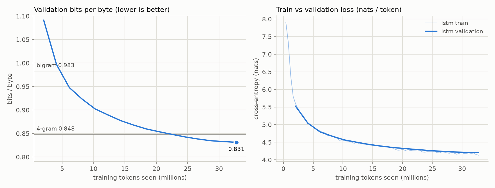
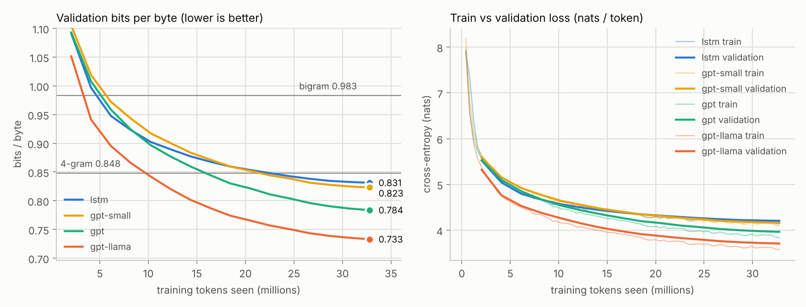

# TinyGPT — a Hindi & Hinglish GPT, built from scratch

A small GPT language model for **Hindi (Devanagari)** and **Hinglish (romanised Hindi-English)**,
written from first principles in Python/PyTorch: tokenizer, data pipeline, LSTM baseline,
transformer, KV-cache, fine-tuning and deployment — no `transformers` model classes.

Why Hindi? Tokenizers built for English handle Devanagari badly. GPT-style pre-tokenisation even
splits Hindi words at every vowel sign, so the same sentence costs far more tokens than in
English — less text fits in the context window and every word costs more compute.
TinyGPT's tokenizer fixes that (see [M1](docs/M1_tokenizer.md)).

## Roadmap

| | Milestone | What gets built |
|---|---|---|
| ✅ | **M1 — Data & tokenizer** | Hindi Wikipedia + Hinglish corpus; byte-level BPE from scratch with a Devanagari-aware regex; comparison with SentencePiece and GPT tokenizers |
| ✅ | **M2 — Baselines** | n-gram models (counting) and an LSTM (hand-written + fused); bits-per-byte evaluation; training loop with exact resume |
| ✅ | **M3 — GPT from scratch** | GPT-2 and Llama recipes (attention by hand + fused kernel, learned positions vs RoPE); trained on the MacBook's GPU against M2's baselines |
| ⬜ | M4 — Inference | temperature / top-k / top-p sampling, KV-cache with an equivalence test and a speed benchmark |
| ⬜ | M5 — Fine-tuning | LoRA from scratch on a Hinglish task |
| ⬜ | M6 — Ship | FastAPI service, Docker image, Gradio demo on Hugging Face Spaces |

## Quick start

```bash
python3 -m venv .venv && source .venv/bin/activate     # Python 3.9+
pip install -e ".[data,compare,dev]"
pytest -q tests/test_bpe.py tests/test_text.py         # M1's tests, a few seconds

python scripts/get_data.py               # 1. corpus: Hindi Wikipedia + Hinglish (~150 MB download)
python scripts/train_tokenizer.py        # 2. BPE tokenizer, 8,192 tokens
python scripts/compare_tokenizers.py     # 3. comparison with GPT-4 regex, SentencePiece, tiktoken
python scripts/encode_dataset.py         # 4. token files for training
```

| Step | Output |
|---|---|
| 1. corpus | `data/clean/{train,val}.jsonl`, `data/clean/stats.json` |
| 2. tokenizer | `tokenizer/tinygpt-indic-8k.json` (+ readable `.vocab.txt`) |
| 3. comparison | `docs/results/tokenizers.md` |
| 4. token files | `data/tokens/{train,val}.bin` (uint16), `meta.json` |

To check the pipeline quickly without the big download, run step 1 as
`python scripts/get_data.py --source dev` (a 5 MB corpus from GitHub); the other steps are the same.

**M2 — baselines** (needs PyTorch):

```bash
pip install -e ".[train]"                      # PyTorch + matplotlib
pytest -q                                      # all tests; two run only on a GPU (Apple MPS / CUDA)

python scripts/ngram_baselines.py              # 5. n-gram baselines, about a minute
python scripts/bench.py                        # 6. how fast does training run on this machine?
caffeinate -i python scripts/train.py          # 7. LSTM baseline (caffeinate keeps a Mac awake)
python scripts/sample.py                       # 8. generate text from the trained LSTM
python scripts/report.py                       # 9. one table with every baseline + learning curves
python scripts/compare_models.py               # 10. per-source scores + LSTM/n-gram mixture
```

| Step | Output |
|---|---|
| 5. n-grams | `docs/results/m2_ngram.md` (+ `.json`) |
| 7. LSTM | `checkpoints/lstm/`: `best.pt`, `last.pt`, `metrics.jsonl`, `results.json` |
| 9. report | `docs/results/m2_baselines.md`, `docs/results/m2_curves.png` |
| 10. comparison | `docs/results/compare.md` |

**M3 — the GPT:**

```bash
python scripts/bench.py --model gpt            # 11. how long will a GPT run take on this machine?
caffeinate -i bash scripts/run_m3.sh           # 12. three GPTs, then tables, curves, attention maps, samples
```

`run_m3.sh` trains `gpt` (GPT-2 recipe, 13.9M parameters), `gpt-small` (5.3M, the LSTM's size) and
`gpt-llama` (RoPE, RMSNorm, SwiGLU), then writes `docs/results/m3_baselines.md`, `m3_curves.png`,
`m3_compare.md`, `m3_context.png`, `attention.png` and `attention_llama.png`. Re-running it skips
finished runs and resumes an interrupted one.

An interrupted run continues exactly where it stopped with `python scripts/train.py --resume`.
Every training setting is a flag (`python scripts/train.py --help`).

## Results (M1, full corpus)

Corpus: 134.7 MB of text → **18.2M training tokens** (Hindi Wikipedia 14.0M, Hinglish 4.1M) and
99.9k validation tokens. Tokens needed per word on held-out text (lower is better):

| Tokenizer | Vocab | Hindi tok/word | Hindi 1-token words | Hinglish tok/word |
|---|---:|---:|---:|---:|
| **TinyGPT BPE (ours)** | 8,192 | **1.65** | 65% | **1.47** |
| same BPE, GPT-4 regex | 8,192 | 2.67 | 10% | 1.34 |
| SentencePiece BPE (same data) | 8,192 | 1.67 | 66% | 1.52 |
| SentencePiece Unigram (same data) | 8,192 | 1.64 | 69% | 1.53 |
| GPT-2 | 50,257 | 8.11 | 2% | 1.69 |
| GPT-4 (cl100k) | 100,277 | 5.28 | 1% | 1.58 |
| GPT-4o (o200k) | 200,019 | 1.83 | 57% | 1.46 |
| characters | — | 5.36 | 1% | 5.14 |
| UTF-8 bytes | — | 13.64 | 1% | 5.14 |

- Same algorithm, data and vocabulary: the Devanagari-aware regex alone needs **38% fewer tokens**
  per Hindi word than GPT-4's regex.
- On par with SentencePiece (1.65 vs 1.67 / 1.64) — a from-scratch tokenizer at library quality.
- **4.9× fewer tokens than GPT-2** and **3.2× fewer than GPT-4** on Hindi, and 10% fewer than
  GPT-4o with a vocabulary 24× smaller. On Hinglish it matches GPT-4o (1.47 vs 1.46).
- Hinglish is 11% of the bytes but 23% of the training tokens: romanised text packs about
  3.5 bytes into a token, Devanagari about 8.5.

Full table with bytes/token: [docs/results/tokenizers.md](docs/results/tokenizers.md).

## Results (M2, baselines)

Validation bits per byte — total cross-entropy divided by the size of the text, so it doesn't
depend on the tokenizer (lower is better; details in [M2](docs/M2_baselines.md)):

| Model | Size | Bits/byte | Hindi | Hinglish |
|---|---|---:|---:|---:|
| uniform (1/8,192 per token) | — | 1.781 | 1.572 | 3.738 |
| unigram | 8k counts | 1.482 | 1.303 | 3.166 |
| bigram | 1.7M counts | 0.983 | 0.915 | 1.617 |
| trigram | 8.9M counts | 0.877 | 0.838 | 1.239 |
| 4-gram | 20.6M counts | 0.848 | 0.829 | **1.029** |
| **LSTM**, 2 × 384 (16 min on the M2's GPU) | 5.5M parameters | **0.831** | **0.785** | 1.265 |
| LSTM + 4-gram mixture | both | 0.766 | 0.740 | 1.016 |



- The LSTM beats every n-gram overall and on Hindi with a quarter of the stored numbers, and was
  still improving when its 32.8M-token budget ran out.
- The 4-gram wins on Hinglish: its validation sentences mostly repeat training phrases (only 2.4%
  of Hinglish-TOP's 4-grams are new), which exact counts replay perfectly — memorisation vs
  generalisation.
- Mixing the two gives 0.766: they know different things. That is the bar for M3's GPT.

## Results (M3, GPT from scratch)

Same data, same 32.8M training tokens, same evaluation as M2 (details in [M3](docs/M3_gpt.md)):

| Model | Size | Bits/byte | Hindi | Hinglish | Time on the M2 GPU |
|---|---|---:|---:|---:|---:|
| 4-gram (M2) | 20.6M counts | 0.848 | 0.829 | **1.029** | — |
| LSTM (M2) | 5.5M | 0.831 | 0.785 | 1.265 | 16 min |
| GPT-2 recipe, 4 × 256 | 5.3M | 0.823 | 0.770 | 1.319 | 18 min |
| GPT-2 recipe, 6 × 384 | 13.9M | 0.784 | 0.735 | 1.241 | 50 min |
| **Llama recipe, 6 × 384** (RoPE, RMSNorm, SwiGLU) | 13.8M | **0.733** | **0.689** | 1.147 | 53 min |



- At the LSTM's size, attention wins by only 1%; scale (2.6× parameters) gives 4.7%; the 2023
  recipe another **6.5% at the same size** — 12% better than the LSTM, 14% better than the 4-gram.
- Only the RoPE model keeps using context beyond ~64 tokens, and only it has started to copy a
  repeated random sequence: its heads form the classic previous-token → induction circuit (72% of
  one head's attention goes to the previous token; another head puts 23% on the copy target).
- The 4-gram still wins on templated Hinglish; mixing it with the best GPT gives 0.701.

## Project layout

```
src/tinygpt/
  bpe.py        byte-level BPE: training (incremental pair counts + heap), encode, decode, save/load
  text.py       NFC normalisation, whitespace clean-up, script detection, train/val split
  data.py       corpus sources: Hindi Wikipedia, Hinglish datasets, small dev corpus
  dataset.py    memory-mapped token files: random training windows, exact evaluation windows
  metrics.py    bits per byte, overall and per language
  trainer.py    training loop: AdamW, warm-up + cosine, clipping, checkpoints, exact resume
  sampling.py   temperature and top-k sampling
  models/
    ngram.py    n-gram counts as sorted int64 codes; add-k and Jelinek-Mercer smoothing
    lstm.py     LSTM language model; ScratchLSTM = the same LSTM written gate by gate
    gpt.py      GPT: GPT-2 / Llama recipes, attention by hand or fused, RoPE, RMSNorm, SwiGLU
scripts/        get_data · train_tokenizer · compare_tokenizers · encode_dataset ·
                ngram_baselines · bench · train · sample · report · compare_models · attention ·
                run_m3.sh
tests/          round trips on random Unicode, fast BPE == naive BPE, hand-written LSTM ==
                nn.LSTM, n-gram scores == full distributions, stop-and-resume == uninterrupted, ...
docs/           one guide per milestone (concepts, decisions, interview questions)
```

## Data and licences

| Source | Used for | Licence |
|---|---|---|
| [Hindi Wikipedia](https://huggingface.co/datasets/wikimedia/wikipedia) (20231101.hi) | Hindi text | CC BY-SA 4.0 |
| [findnitai/english-to-hinglish](https://huggingface.co/datasets/findnitai/english-to-hinglish) | Hinglish sentences | Apache-2.0 |
| [Hinglish-TOP](https://github.com/google-research-datasets/Hinglish-TOP-Dataset) | Hinglish queries | Apache-2.0 |
| [UD Hindi HDTB](https://github.com/UniversalDependencies/UD_Hindi-HDTB) | dev corpus only | CC BY-NC-SA 4.0 |

The data is downloaded by the scripts and never committed. Code: MIT.
