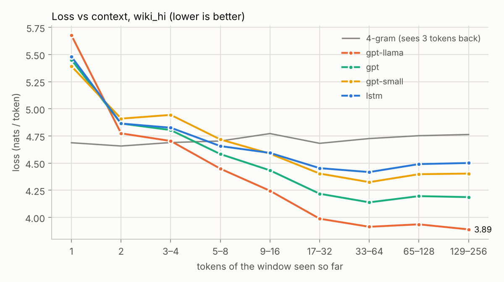
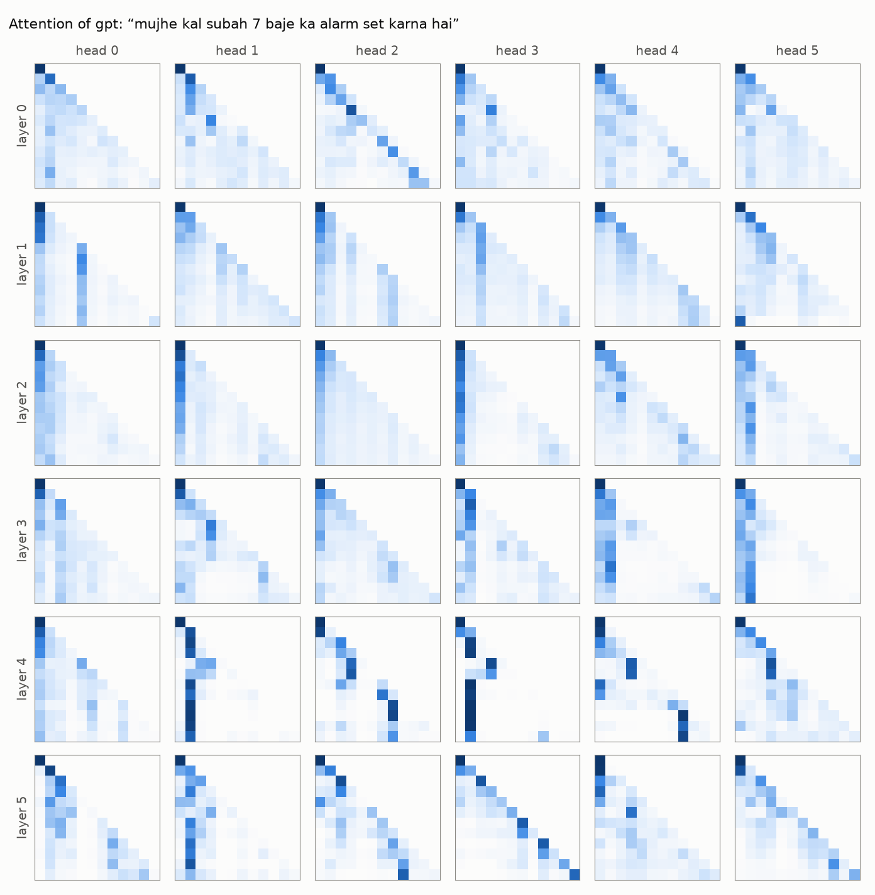
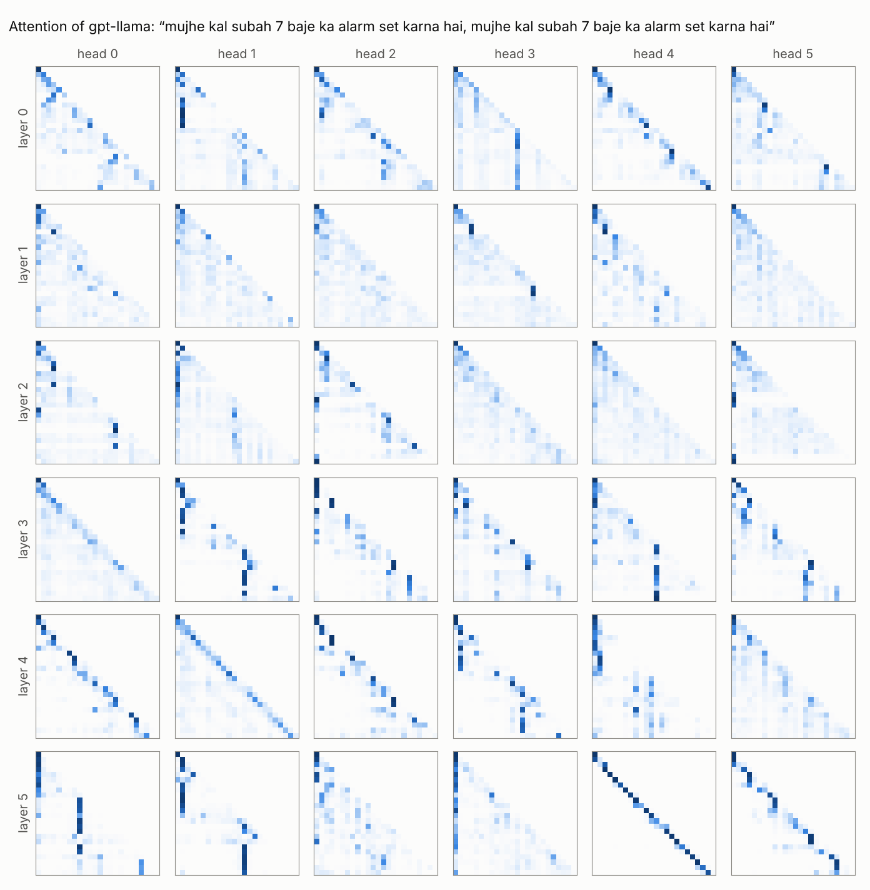

# M3: A GPT from scratch

**Goal:** a Transformer language model written from first principles, trained on exactly the same
tokens, budget and evaluation as M2's baselines, so the results answer one question cleanly:
*what does attention buy over counting (n grams) and over recurrence (the LSTM)?*

```
ids ─ token embedding (+ positions) ─ Block × 6 ─ final norm ─ output layer (= embedding) ─ logits
Block:   x = x + Attention(Norm(x))      tokens look at each other
         x = x + MLP(Norm(x))            each token processes what it gathered
```

## 1. Self attention, step by step (`models/gpt.py: CausalSelfAttention`)

Every token's vector x is projected three ways:

| projection | meaning |
|---|---|
| query q = x·W_q | what am I looking for? |
| key k = x·W_k | what do I contain? |
| value v = x·W_v | what do I pass on if you pick me? |

```
scores  = q · kᵀ / √d_head          (T × T: how well each query matches each key)
scores  = minus infinity above the diagonal  (causal mask: token t may not look at t+1, t+2, …)
weights = softmax(scores)            each row is a probability distribution over earlier tokens
out     = weights · v                each token gets a weighted mix of earlier tokens' values
```

- **Why divide by √d_head?** The dot product of two random d dimensional vectors has a spread that
  grows like √d. Without the division, scores get large, softmax becomes nearly one hot, and its
  gradients vanish.
- **Why the causal mask makes training parallel.** All 256 positions of a window are predicted in one
  pass (each from its own past only), so one forward pass gives 256 training signals. The LSTM also
  predicts every position, but must compute them one after another; attention computes them all at
  once: that is why Transformers use GPUs so much better.
- **Multi head.** Instead of one 384 dimensional attention, 6 heads of 64 dimensions each attend
  independently (one may follow the previous token, another the start of the sentence), and a final
  projection mixes their outputs.
- **Cost.** The score matrix is T × T: quadratic in context length. At T = 256 that is cheap; it is
  why long context models need tricks.

**Two implementations, one function.** The hand written version above is what you should be able to
write on a whiteboard (and it can record attention maps for plotting). Training uses
`F.scaled_dot_product_attention`, PyTorch's fused kernel (on NVIDIA GPUs it never even stores the
T × T matrix: FlashAttention).
`tests/test_gpt.py` checks that both give the same outputs and gradients, and that changing token t
never changes a prediction before t.

## 2. The rest of the model

**Residual stream.** Each block *adds* its output to x (x + f(x)) instead of replacing it. The
stream is a running sum every layer reads from and writes to, and gradients flow straight down it:
the same trick that lets the LSTM's cell carry gradients across time, applied across depth.

**Pre norm.** The original Transformer normalised *after* adding (post norm), which makes deep stacks
hard to train without very careful warmup. GPT 2 normalises the *input* of each branch and adds a
final norm before the output layer; the residual path itself is never normalised.

**MLP.** A small two layer network applied to each token separately (384 → 1,536 → 384, GELU). It
holds two thirds of each block's parameters. A useful picture: attention moves information between
tokens, the MLP transforms it within a token.

**Positions.** Attention by itself is order blind: shuffle the earlier tokens and every weight just
moves with them. So positions must be injected:
- *learned positions* (GPT 2): one trained vector per position 0 to 255, added to the token embedding;
- *RoPE* (Llama): rotate each query and key by an angle proportional to its position, so q_m · k_n
  depends only on the distance m minus n. No parameters, and attention sees relative positions directly
  (`test_rope_is_relative` checks this).

**Initialisation.** Weights ~ N(0, 0.02); the two projections that write into the residual stream are
scaled down by 1/√(2 × layers), so the stream's variance doesn't grow with depth (GPT 2's recipe).
The output layer reuses the embedding matrix (weight tying, as in M2). The first loss is
ln 8192 ≈ 9.01 plus a little: `test_initial_loss_is_log_vocab`.

**Two recipes in one class** (`--style`):

| | GPT 2 (2019) | Llama (2023) |
|---|---|---|
| positions | learned table | RoPE (rotations, no parameters) |
| normalisation | LayerNorm (subtract mean, divide by std, gain + bias) | RMSNorm (divide by root mean square, gain only) |
| MLP | 384 → 1,536 → 384, GELU | SwiGLU: two 384 → 1,024 maps, one gating the other, → 384 |
| biases | yes | none |
| parameters (6 × 384) | 13.89M | 13.77M |

SwiGLU's hidden size 1,024 = 8/3 × 384 keeps the parameter count equal to the GELU MLP (three
matrices instead of two), so the comparison is about the components, not the size.

**Generation** rereads the last 256 tokens for every new token. That is wasteful (the keys and values
of old tokens never change) and M4 fixes it with a KV cache.

## 3. Training: the same pipeline as M2

Data, windows (32 × 256 tokens per step), 4,000 steps (32.8M tokens, 1.8 epochs), warmup + cosine
schedule, clipping at 1.0, exact evaluation, checkpoints and resume: all unchanged from M2, so every
difference in the results comes from the model. Transformer specific settings:

| setting | value | why |
|---|---|---|
| peak learning rate | 0.001 → 0.0001 (cosine) | measured: beat 0.0003 and 0.003 (below) |
| weight decay | 0.1 on matrices | the usual Transformer setting (GPT 3, nanoGPT) |
| dropout | 0.1 | same as the LSTM; 2.4 training tokens per parameter is little data |

**The learning rate was measured, not guessed** (600 steps of 8 × 256 tokens on CPU, cosine
schedule over those steps, the main 13.9M model):

| peak learning rate | val loss after 200 / 400 / 600 steps |
|---|---|
| 0.0003 | 6.39 / 5.97 / 5.85 |
| **0.001** | **6.22 / 5.81 / 5.64** |
| 0.003 | 6.42 / 6.03 / 5.84 |

0.001 beat both neighbours at every evaluation: the same value nanoGPT uses for this model size.
The LSTM wanted 0.01; the Transformer wants a rate 10× smaller. Each architecture gets its own.

Three runs, all with the same data and budget:

| run | what it answers |
|---|---|
| `gpt`: GPT 2 recipe, 6 layers × 384, 13.9M parameters | the main model |
| `gpt-small`: GPT 2 recipe, 4 layers × 256, 5.3M | attention vs recurrence at the LSTM's size (5.5M) |
| `gpt-llama`: Llama recipe, 6 × 384, 13.8M | do the 2023 components beat the 2019 ones at this scale? |

## 4. Results

All three trained on the M2's GPU with the same 32.8M tokens: `gpt` in 50 minutes (~11k tokens/s),
`gpt-small` in 18, `gpt-llama` in 53.

| model | size | loss/token | bits/byte | Hindi | Hinglish |
|---|---|---:|---:|---:|---:|
| 4 gram (M2) | 20.6M counts | 4.291 | 0.848 | 0.829 | **1.029** |
| LSTM (M2) | 5.5M parameters | 4.206 | 0.831 | 0.785 | 1.265 |
| LSTM + 4 gram mixture (M2's bar) | both | n/a | 0.766 | 0.740 | 1.016 |
| `gpt-small`, GPT 2 recipe, 4 × 256 | 5.3M | 4.164 | 0.823 | 0.770 | 1.319 |
| `gpt`, GPT 2 recipe, 6 × 384 | 13.9M | 3.965 | 0.784 | 0.735 | 1.241 |
| **`gpt-llama`**, Llama recipe, 6 × 384 | 13.8M | **3.708** | **0.733** | **0.689** | 1.147 |
| `gpt-llama` + 4 gram mixture (0.8 / 0.2) | both | n/a | 0.701 | 0.669 | 0.995 |


**What each comparison says:**
- **Attention vs recurrence at equal size: a small win.** `gpt-small` (5.3M) beats the LSTM (5.5M) by
  only 1% (0.823 vs 0.831): better on Hindi, worse on Hinglish. At this size and budget, attention
  alone is not magic.
- **Scale: 2.6× the parameters → 4.7% better** (`gpt` 0.784 vs `gpt-small` 0.823), at the same number
  of training tokens.
- **The 2023 recipe: 6.5% better at the same size and speed** (`gpt-llama` 0.733 vs `gpt` 0.784):
  the largest single gain in M3, and the only model that beats M2's mixture bar (0.766) on its own.
  It is 12% better than the LSTM and 14% better than the 4 gram. All runs were still improving when
  the budget ran out.
- **The 4 gram still wins on Hinglish** (1.029 vs 1.147): templated phrases are still best replayed
  from counts. Mixing it in still helps the best GPT: 0.701 overall.

Per source (`results/m3_compare.md`):

| source | 4 grams unseen in training | 4 gram | `gpt-llama` | gpt | `gpt-small` | LSTM |
|---|---:|---:|---:|---:|---:|---:|
| Hindi Wikipedia | 68.6% | 0.829 | **0.689** | 0.735 | 0.770 | 0.785 |
| findnitai | 24.6% | **1.233** | 1.303 | 1.405 | 1.488 | 1.435 |
| Hinglish TOP | 2.4% | **0.746** | 0.931 | 1.012 | 1.083 | 1.029 |

**How far back does each model look?** Loss on Hindi Wikipedia by how many tokens of the window the
model had read (`results/m3_context.png`). To compare models fairly across window positions, here is
each model's gain over the 4 gram in the same tokens (nats per token; "worse" marks a loss to the 4 gram, plain numbers are gains):

| tokens read | 1 | 2 | 3 to 4 | 5 to 8 | 9 to 16 | 17 to 32 | 33 to 64 | 65 to 128 | 129 to 256 |
|---|---:|---:|---:|---:|---:|---:|---:|---:|---:|
| LSTM | 0.79 worse | 0.21 worse | 0.14 worse | 0.05 | 0.18 | 0.23 | **0.31** | 0.26 | 0.26 |
| `gpt-small` | 0.71 worse | 0.25 worse | 0.26 worse | 0.01 worse | 0.19 | 0.28 | **0.40** | 0.36 | 0.36 |
| `gpt` | 0.76 worse | 0.21 worse | 0.12 worse | 0.12 | 0.34 | 0.47 | **0.59** | 0.56 | 0.58 |
| `gpt-llama` | 0.99 worse | 0.12 worse | 0.01 worse | 0.26 | 0.53 | 0.70 | 0.81 | 0.82 | **0.87** |



Every neural model starts *worse* than the 4 gram (after 1 to 4 tokens of a window it has less to go
on than a 4 gram, which always sees three tokens back), overtakes it after 5 to 8 tokens, and then pulls
away. The LSTM and both GPT 2 style models stop gaining after 33 to 64 tokens; only the Llama style
model keeps improving to the full 256.

**Copying a random sequence** (100 random tokens shown twice; loss in nats/token):

| model | 1st copy | 2nd copy | gain |
|---|---:|---:|---:|
| LSTM | 13.27 | 13.16 | 0.11 |
| `gpt-small` | 13.45 | 13.32 | 0.13 |
| gpt | 13.26 | 12.97 | 0.29 |
| **`gpt-llama`** | 13.19 | **11.90** | **1.29** |

None of the models has learned to copy reliably (a perfect copier would score near 0 on the second
copy), but only the Llama style one has started.

**Why? The attention heads tell the story.** A census over Hindi Wikipedia windows (share of each
head's attention going to the previous token), and in the copying test (share going to the token
*after* the earlier occurrence of the current token, which is what an *induction head* does):

| | strongest previous token heads | strongest induction score |
|---|---|---|
| gpt (GPT 2 recipe) | 31% (layer 4, head 4) | 3% |
| `gpt-llama` | **72%** (layer 4, head 1), **51%** (layer 3, head 0) | **23%** (layer 5, head 3) |

This is the classic two step copying circuit (Olsson et al., 2022) starting to form: a head in an
early layer marks each token with the token before it, and a head in a later layer looks for "the
place where the current token appeared before" and reads what came next. Only the RoPE model has
it. The likely reason: with RoPE, "look one token back" is the same rotation at every position, so
it is learned once; with learned positions, the model must learn it separately for every pair of
positions, which this budget wasn't enough for. (M3 changed four components at once, so this was a
hypothesis. **M4 tested it:** the GPT 2 recipe with only RoPE swapped in reaches 0.737 bits/byte (91%
of the gain) and grows the same circuit: a 75% previous token head in layer 1 and an 18% induction
head in layer 4. See [M4 §5](M4_inference.md#5-m3s-open-question-is-it-rope).)




**Samples** (`gpt-llama`, temperature 0.8, top k 50):

> भारत की राजधानी पटना का एक प्रमुख शहर है। यह दिल्ली से 70 किलोमीटर की दूरी पर अवस्थित है। इसकी
> स्थापना 16वीं और 17वीं शताब्दी के दौरान हुई थी। इसका उद्देश्य यहाँ पर शासन करना था।

> yaar kal movie dekhne ke liye / mujhe ek 10 minute ka timer chahiye . / mere liye Drake ka
> music bajao / mai 10 minutes ke liye timer set karna chahta hu .

Compared with M2's LSTM, the Hindi now stays on one subject for a whole paragraph (a city, its
distance from Delhi, when it was founded) even though the facts are invented (a 13.8M parameter
model trained on 33M tokens memorises style, not knowledge).

**Going forward:** by the rule fixed in advance (decision 15), `gpt-llama` is the model for M4 to M6.

## 5. Decisions we made, and why

Each entry: what we chose → why → the alternatives and why we didn't pick them.

**1. A decoder only Transformer.** Why: our task is predicting the next token, the same objective as
M2's baselines, so the numbers compare directly; it is also the architecture of GPT and Llama. Not
chosen: *encoder only (BERT)*: sees both directions, can't generate; *encoder decoder (T5)*: built
for input → output tasks like translation, more machinery than language modelling needs.

**2. 6 layers × 384 wide × 6 heads (13.9M parameters).** Why: the size of nanoGPT's "baby GPT", known
to train well on small datasets with exactly this context length; heads of 64 dimensions, the
standard size; a run of about 50 minutes on the MacBook. Not chosen: *bigger* (8 × 512, ~30M):
twice the time, and 18M training tokens would be thin for it; *only small models*: then the
size matched comparison would be all we learn.

**3. The same budget and windows as the LSTM.** Why: one difference at a time. Not chosen: *training
each model "until done"*: then the better model might just have had more compute.

**4. A size matched GPT (`gpt-small`, 5.3M vs the LSTM's 5.5M).** Why: the main GPT has 2.5× the LSTM's
parameters, so on its own a win could be "just size". The small one isolates the architecture.
Not chosen: *matching non embedding parameters at width 384*: one and a half layers, not a sensible
model.

**5. Pre norm blocks plus a final norm.** Why: trains stably without careful warmup; what GPT 2 and
every modern LLM use. Not chosen: *post norm (the 2017 original)*: needs long warmup and is fragile
in deep stacks.

**6. Learned positions in the main model, RoPE in the Llama variant.** Why: learned positions are the
simplest correct choice for a fixed 256 token context and match GPT 2; RoPE is what current LLMs use
and the experiment shows whether it matters here. (It did: the RoPE model is the only one that keeps
using context beyond ~64 tokens and the only one forming a copying circuit, see §4.) Not chosen: *sinusoidal positions* (the 2017
original): fixed, fine, but superseded by both; *ALiBi*: another relative scheme, less widely used.

**7. Weight tying.** Why: saves 3.1M parameters (a fifth of the model) and helps small models: same
reasoning as M2. GPT 2 does it.

**8. GPT 2 initialisation (0.02, residual projections scaled by 1/√(2L)).** Why: keeps every layer's
output on the same scale at the start. M2 found that small starting weights stalled the LSTM; here
they don't (in the learning rate check the loss was already 6.2 after 200 steps), which is
consistent with M2's explanation: at a 10× smaller learning rate, Adam's fixed size steps take far
longer to swamp the small starting values. Not chosen: *M2's uniform init between minus 0.1 and 0.1*: there is no problem to
fix here, and GPT 2's recipe is the reference point.

**9. Hand written attention + PyTorch's fused kernel, tied by a test.** Why: the manual version is
the explanation (and draws attention maps), the fused one is faster and leaner; the test proves the
explanation describes what was trained: same idea as M2's LSTM.

**10. Learning rate 0.001, weight decay 0.1, β₂ = 0.99, 100 warmup steps.** Why: 0.001 beat 0.0003
and 0.003 at every evaluation of a 600 step test (§3). Weight decay 0.1 and β₂ = 0.99 follow nanoGPT's
small data settings. Not chosen: *the LSTM's 0.01*:
Transformers without careful tuning diverge at such rates; each architecture gets its own best rate.

**11. Dropout 0.1.** Why: identical to the LSTM, and with 2.4 tokens per parameter some regularisation
is reasonable. Large scale pretraining uses none because data vastly outnumbers parameters; here it
doesn't.

**12. fp32 on the Mac's GPU.** Why: still the safest and simplest choice; mixed precision on Apple GPUs
adds another variable for a speedup we don't need at this size.

**13. No KV cache yet.** Why: M3 is about the model; M4 adds the cache and proves it gives identical
outputs before measuring the speedup.

**14. Three new analyses: loss vs context, a copying test, attention maps.** Why: a single number says
*how much* better a model is; these show *why*: how far back each model actually uses information,
whether it can retrieve something it saw 100 tokens ago, and what its heads attend to.

**15. The best model on validation goes forward to M4 to M6.** Why: a rule fixed before seeing results.
Outcome: `gpt-llama`.

**16. The same evaluation as M2: nonoverlapping 256 token windows.** Why: every number stays
comparable with M2's table. Not chosen: *sliding window evaluation* (each token gets nearly full
context): it would flatter the models that use long context most, and the loss vs context analysis
already shows exactly how much context is worth to each model.

## 6. Interview questions you should be able to answer

1. **Explain self attention.** Queries, keys and values are projections of each token; each query
   is compared with every earlier key (scaled dot product), softmax turns the scores into weights,
   and the output is the weighted sum of values.
2. **Why divide by √d_k?** Dot products grow like √d; without scaling, softmax saturates and
   gradients vanish.
3. **How can a decoder train on all positions at once?** The causal mask: each position attends only
   to earlier ones, so one pass gives a prediction for every position without leaking the future.
4. **Why several heads?** Different heads can track different relations (previous token, same word,
   sentence start) at the same cost as one big head.
5. **What is the cost of attention?** O(T²·d) per layer in time and (without fused kernels) O(T²)
   memory per head: quadratic in context length.
6. **Pre norm vs post norm?** Pre norm normalises each branch's input and leaves the residual path
   clean, so deep models train stably; post norm (the original) needs long warmup.
7. **Why does a Transformer need positional information? Learned vs sinusoidal vs RoPE?** Attention
   is permutation equivariant. Learned: a vector per position (fixed maximum length). Sinusoidal:
   fixed waves. RoPE: rotates q and k so their product depends on relative distance.
8. **What does the MLP do, and where are the parameters?** A per token two layer network, about two
   thirds of each block (8d² of 12d²); attention's four d × d projections are the rest.
9. **Why scale the residual projections at initialisation?** Each block adds to the stream; without
   1/√(2L), its variance grows with depth.
10. **RMSNorm vs LayerNorm, SwiGLU vs GELU?** RMSNorm drops the mean and bias: cheaper, works as well.
    SwiGLU gates one projection with another; at equal parameters it usually trains a little better.
11. **What are induction heads?** Pairs of heads that find an earlier occurrence of the current token
    and copy what followed it: the mechanism behind copying and much of in context learning. (Your
    RoPE model grew a weak one: layer 5, head 3, fed by previous token heads in layers 3 to 4.)
12. **Why can a GPT copy a long random sequence when an LSTM can't?** Attention can look up any earlier
    token directly; the LSTM must squeeze everything into a fixed size state. (In your runs only the
    RoPE model had started to: 13.19 → 11.90 nats on the second copy.)
13. **What does generating a token cost without a KV cache?** A full forward pass over the context for
    every new token: O(T) work per token, O(T²) for a sequence; the cache makes it O(1) new
    keys/values per token plus attention over the cache.
14. **How many parameters does your model have, and where?** 13.9M: 3.1M token embeddings (shared with
    the output layer), 0.1M positions, 10.6M in the six blocks (1.77M each).
15. **Your Llama style model beat the GPT 2 style one by 6.5% at the same size. What changed, and
    which change matters most?** RoPE, RMSNorm, SwiGLU, no biases. The context curve and the head
    census point to RoPE: relative positions make "look one token back" one pattern instead of 256.
    (M4's ablation confirmed it: RoPE alone gives 5.9 of the 6.5%.)

## 7. Try it yourself

- Remove the √d scaling, train for 500 steps and compare the curves.
- Turn off the causal mask in the manual attention: what happens to the training loss, and why is the
  model useless for generation?
- Train with 2 heads of 192 or 12 heads of 32 instead of 6 of 64.
- Swap only one Llama component at a time to see which one matters. (M4 did RoPE: 91% of the gain.
  RMSNorm alone and SwiGLU alone are still open.)
- Run the copying test with sequences of 20, 50 and 120 tokens.
