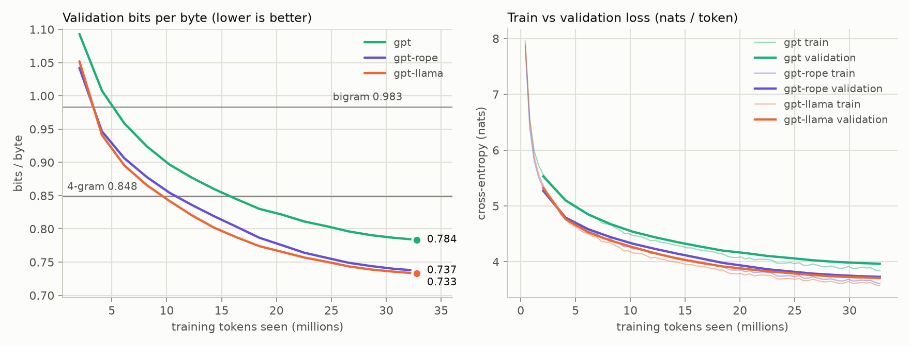

# M4 Inference: decoding strategies, a KV cache, streaming

**Goal:** turn M3's best model (`gpt-llama`) into a fast, well behaved text generator, and
understand every choice: how the next token is picked, why generation gets slower with every token
unless keys and values are cached, how to *prove* the cache changes nothing, and how to stream Hindi
text without breaking characters. M4 also answers M3's open question: does RoPE alone explain the
Llama recipe's win?

```
prompt ─ prefill (one pass, fills the cache) ─┬─ logits ─ penalties ─ temperature ─ top k / top p / min p ─ sample
                                              └─ decode: 1 new token per pass, reading the cache ─┘   (repeat)
```

## 1. Decoding strategies (`sampling.py`)

The model gives a score (logit) for each of the 8,192 tokens. How we pick one matters as much as the
model:

| strategy | what it does | weakness |
|---|---|---|
| greedy | always the most likely token | loops: the same likely sentence comes back forever |
| temperature T | divide logits by T before softmax: T < 1 sharper, T > 1 flatter | high T: word salad |
| top k | keep the k most likely tokens, renormalise | a fixed k is too many when the model is sure, too few when it isn't |
| top p (nucleus) | keep the smallest set of tokens whose probabilities add up to p | adapts to the model's confidence |
| min p | keep tokens at least min_p × the best token's probability | adapts too, and is simpler to reason about |
| repetition penalty | before everything else, push down tokens already in the text (÷ or × the logit) | also penalises words that *should* repeat (है, का, ke) |

`filter_logits` applies them in that order (penalty → temperature → top k → top p → min p);
`sample_next` then draws a token. `tests/test_sampling.py` checks each rule on a handmade
distribution.

**Measured, not eyeballed** (`scripts/decoding.py`): 10 prompts taken from validation documents,
80 new tokens, scored by how likely the model finds the text (nll, nats per token), how varied it is
(distinct 2) and how much it loops (repeat 4). The first row scores what the documents really say
next: the text a strategy should resemble:

| strategy | nll | distinct 2 | repeat 4 |
|---|---:|---:|---:|
| **real text** | **2.96** | **0.95** | **0.00** |
| greedy | 0.99 | 0.25 | 0.73 |
| greedy + repetition penalty 1.3 | 1.57 | 0.98 | 0.00 |
| temperature 0.7 | 1.74 | 0.83 | 0.06 |
| temperature 1.0 (pure sampling) | 2.85 | 0.94 | 0.01 |
| temperature 1.3 | 5.38 | 0.99 | 0.00 |
| top k 50 | 2.22 | 0.92 | 0.01 |
| top p 0.9 | 2.14 | 0.88 | 0.03 |
| min p 0.1 | 1.59 | 0.83 | 0.05 |

(Real text scores 2.96 here, below the full validation loss of 3.71: half of these prompts are
Hinglish, which costs fewer nats per token, and document openings are formulaic.)

- **The most likely text is not humanlike.** Greedy text is three times as predictable as real text
  (0.99 vs 2.96 nats), and 73% of its 4 token sequences are repeats: "यह गाँव ३००० वर्ग किलोमीटर की
  दूरी पर स्थित है।" three times in a row. A repeated phrase makes itself more likely, so
  maximising probability step by step walks into loops (Holtzman et al., 2019, saw the same in GPT 2).
- **A repetition penalty stops the loops without randomness** (repeat 4 0.00), but it overshoots: its
  text is *more* varied than real text (0.98 vs 0.95), because Hindi should repeat है, के, में. And
  it is still deterministic: one prompt, one text.
- **Pure sampling matches real text on all three numbers** (2.85 / 0.94 / 0.01), and still reads
  worse: it invents words ("चिन्नाचल प्रदेश"). **Temperature 1.3** is word salad (nll 5.38; an
  English "remind" lands in a Hindi sentence).
- **Truncation trades fidelity for safety.** top k 50, top p 0.9 and min p 0.1 make the text more
  predictable than human text (nll 1.6 to 2.2) and keep the loops away. min p 0.1 matches temperature
  0.7's variety (0.83 / 0.05 vs 0.83 / 0.06) with more likely text (1.59 vs 1.74).

**Why does cutting the tail help?** The paper behind top p says the distributions of language
models "have an unreliable tail which needs to be truncated during generation". Two measurements
(same script) show what that means for our model:

| rule (temperature 1) | probability it removes | real next tokens it removes |
|---|---:|---:|
| top k 50 | 20.2% | 22.9% |
| top p 0.9 | 9.2% | 11.5% |
| min p 0.1 | 35.6% | 38.5% |

- **The tail is not overweighted.** Over all 99,855 validation predictions, the real next token
  lands in the removed part about as often as the removed probability says. The model is honest
  about *how much* it doesn't know; what it can't tell is *which* unusual token is right. A sampled
  tail token is a guess among thousands, and a 14M parameter model guesses badly there. Truncation
  gives up the real tail tokens (11 to 38% of what people actually write) to avoid those guesses.
- **It doesn't lose its way.** Reading its own pure samples, the model is only 0.1 to 0.2 nats more
  uncertain than on real text (entropy of its predictions: 3.14 to 3.36 vs 2.93 to 3.16 over 200 tokens of
  48 Wikipedia articles), and the gap doesn't grow. Each bad guess costs a bad word; it doesn't send
  the model into a spiral, at least not within 200 tokens.

## 2. The KV cache (`models/gpt.py`)

**Why generation slows down.** To produce token t, the model runs on all t tokens so far, and then
does it again, for t + 1 tokens, to produce the next one. Generating n tokens costs about
1 + 2 + … + n ≈ n²/2 token passes.

**Why a cache is allowed.** Because of the causal mask, a token's keys and values depend only on the
tokens *before* it, so they never change once computed. Store them, and each new token needs only
its own query, key and value, plus attention over the stored ones:

```
prefill:  the whole prompt in one pass  → fills the cache, gives the first prediction
decode:   1 new token per pass          → appends its key/value, attends to everything stored
```

**Layout.** One preallocated buffer per K and V: `(layers, batch, heads, 256 positions, 64 dims)`,
filled in place with a pointer to the next free position. For our model that is
2 × 6 layers × 6 heads × 256 × 64 × 4 bytes = **4.7 MB per sequence**. The same formula for
Llama 2 7B (32 layers, 32 heads of 128, 4,096 token context) in fp16 gives **2.1 GB per sequence**:
half a megabyte per token. That is why the KV cache, not the weights, limits how many users an
LLM server can handle, and why newer models share keys and values between heads (multi query /
grouped query attention).

**Positions.** New tokens continue from the cache's position: learned positions look up
`wpe[pos … pos+T]`; RoPE rotates the new queries and keys by *their* positions (stored keys were
rotated when they were stored). A single new token needs no mask: it may see everything stored.

**When the window is full.** Positions can't go past 256 (the learned table ends there; RoPE angles
beyond 256 were never trained). So the cache starts over from the last 128 tokens of the text,
rereading them at positions 0 to 127, and decoding continues. Without a cache, the model instead
rereads the last 256 tokens every step: the two behave identically until the window first fills.

**Proving it changes nothing** (`tests/test_kvcache.py`), for both recipes and both attention
implementations:
- prefill 5 tokens, then feed one at a time: every logit equals the full forward pass (to 0.00001);
- greedy *and* seeded random generation give identical tokens with and without the cache;
- 3 prompts in one batch give the same tokens as 3 separate runs;
- going past the window works, and overfilling the cache is an error, not silent garbage.

**The LSTM** never needed this: its (h, c) state is a fixed size summary, so constant time *and*
memory per token. The price is what M3 showed: a fixed size summary forgets.

## 3. Streaming (`sampling.stream`)

`stream()` yields text as each token is chosen (M6's web demo will use it). The catch is Hindi:
tokens are *bytes*, every Devanagari letter is 3 bytes, and a token can end after the first 2. Decoding
each token separately would print "�". An incremental UTF8 decoder holds the incomplete bytes until
the character is whole; `test_streamed_text_equals_full_decode` checks that streamed text equals
decoding everything at once.

## 4. Speed (`scripts/bench_generate.py`)

Greedy, 240 new tokens after an 8 token prompt, batch 1, every token timed, on the MacBook Air M2's
CPU and GPU (`docs/results/m4_generation.md`):

| model | device | tokens/s | ms/token, first 20 | ms/token, last 20 | slowest token (ms) | tokens/s, batch of 16 |
|---|---|---:|---:|---:|---:|---:|
| `gpt-llama`, no cache | CPU | 108.4 | 3.8 | 14.5 | 14.9 | 169 |
| `gpt-llama`, KV cache | CPU | 549.9 | 1.9 | 1.8 | 3.1 | 3,314 |
| LSTM | CPU | 3,201 | 0.3 | 0.3 | 0.4 | 13,035 |
| `gpt-llama`, no cache | GPU | 140.3 | 8.3 | 8.2 | 32.9 | 335 |
| `gpt-llama`, KV cache | GPU | 274.1 | 3.6 | 3.2 | 9.9 | 3,415 |
| LSTM | GPU | 882 | 1.1 | 1.1 | 1.3 | 12,406 |

(tokens/s = 240 ÷ total time; first/last 20 = median time of those tokens.)


- **Without the cache, every token is slower than the one before** (CPU: 3.8 ms early, 14.5 ms after
  240 tokens): the work per token grows with the context, so the total grows with its square. With
  the cache the time per token stays flat (1.8 to 1.9 ms): **5.1× faster** over 240 tokens, 8× by the
  end, and the gap keeps widening with length.
- **Flat, not free.** Attention over the cache does grow with the context, but it is a small part of
  each step: one multiply add per weight (13.8M) plus 2 × 6 layers × 384 × L for QKᵀ and the
  weighted sum of V: 1.1M at L = 248, 8% of the step.
- **At batch 1 the CPU beats the GPU**: 550 vs 274 tokens/s with the cache, 3,201 vs 882 for the
  LSTM. Every step must send its operations to the GPU and wait for the result before it can choose
  the next token, and with one sequence that fixed price is nearly the whole step: a straight line
  through batch 1 and batch 16 puts about 97% of a GPU step in the part that doesn't grow with the
  batch (CPU: about 88%). Give the GPU more work per step and it catches up: with 16 sequences it
  draws level or edges ahead (3,415 vs 3,314 tokens/s; 3,383 vs 2,975 in the first run), and
  without the cache (hundreds of tokens reread in parallel every step) it is faster by the end
  (8.2 vs 14.5 ms per token).
- **So the cache is worth more on the CPU** (5.1× vs 2.0× on the GPU): the CPU pays for every token
  it rereads; the GPU rereads them in parallel, and its time goes to the fixed price instead.
- **The LSTM is fastest everywhere** (3,201 tokens/s on the CPU, 5.8× the cached GPT): 2.5× fewer
  weights and 19 tensor operations per token (two fused LSTM layers) against `gpt-llama`'s 495. Speed
  was never its problem; remembering was (M3).
- **Batching is how servers get throughput.** 16 sequences cost the GPU only about 1.4× the time of
  one (4.7 vs 3.2 to 3.6 ms per step). On big models the fixed price is mostly reading every weight
  from memory once per step, whatever the batch, which is why decoding is called *memory bound*,
  and reading a prompt (many tokens per weight read) *compute bound*.
- **GPU timings are noisy at this size.** We ran the benchmark twice. On the CPU the runs agree to
  within about 7%; on the GPU the first ~100 tokens moved a lot (without the cache: 4.2 ms per token
  at the start of the first run, 8.3 ms in the second; the first run also had one ~0.2 second
  token), while the end of run times agree (8.2 / 8.2 ms without the cache, 3.3 / 3.2 ms with it).
  Likely causes: other work on the same GPU (on a MacBook it also draws the screen) or its clock
  speed changing; we can't tell which from here. The conclusions above hold in both runs.

## 5. M3's open question: is it RoPE?

M3's Llama recipe changed four things at once (RoPE, RMSNorm, SwiGLU, no biases) and beat the GPT 2
recipe by 6.5%. `gpt-rope` changes only one: the GPT 2 recipe (LayerNorm, GELU, biases) with RoPE
instead of learned positions, trained exactly like the other two (same data, seed and 32.8M tokens;
46 min on the M2's GPU).

| model | differs from gpt by | bits/byte | Hindi | Hinglish |
|---|---|---:|---:|---:|
| gpt | n/a | 0.784 | 0.735 | 1.241 |
| **`gpt-rope`** | RoPE | **0.737** | 0.691 | 1.168 |
| `gpt-llama` | RoPE, RMSNorm, SwiGLU, no biases | 0.733 | 0.689 | 1.147 |

| model | strongest previous token head | strongest induction head | copy test: 1st → 2nd copy (nats) |
|---|---|---|---|
| gpt | 31% (layer 4) | 3% (layer 5) | 13.26 → 12.97 |
| `gpt-rope` | 75% (layer 1) | 18% (layer 4) | 13.37 → 12.38 |
| `gpt-llama` | 72% (layer 4) | 23% (layer 5) | 13.19 → 11.90 |



- **Yes: it's RoPE.** Changing only the positions gives 91% of the gain: 5.9% of the 6.5%
  (0.784 → 0.737). RMSNorm, SwiGLU and dropping biases add the last 0.6%, mostly on Hinglish
  (1.168 → 1.147; on Hindi 0.691 vs 0.689). Each model was trained once, so we can't tell whether
  that 0.6% would survive another random seed; the 5.9% is ten times larger.
- **Same circuit.** `gpt-rope` grows the copying circuit M3 found in `gpt-llama`, in the textbook order:
  a previous token head early (75%, layer 1) and an induction head later (18%, layer 4) that builds
  on it. Its second copy of a random sequence costs 1.0 nats less than the first (`gpt-llama` 1.3,
  gpt 0.3).
- **Same use of context.** From 17 tokens of context on, `gpt-rope` stays within about 0.03 nats of
  `gpt-llama`; gpt is 0.22 to 0.30 nats behind, and slightly worse after 64 tokens than at 33 to 64
  (`results/m4_rope_context.png`, full tables in `results/m4_rope_compare.md` and `results/heads.md`).
- **The one place learned positions win: the first token of a window** (5.45 nats vs 5.58 for
  `gpt-rope` and 5.68 for `gpt-llama`). Our guess: `wpe[0]` tells the GPT 2 model it has no context, so
  it can hedge; RoPE only encodes positions *relative* to each other, so a RoPE model can't tell it
  is at the start. One position in 256, so it barely moves the average.

**Why RoPE matters here.** With RoPE, the attention score between two tokens depends on their
contents and on how far apart they are, never on where they are (`test_rope_is_relative`). So "look
one token back" is a single pattern that works at every position. With learned positions it has to
be built out of 256 separately learned vectors, and on 33M training tokens the GPT 2 recipe never got
there. The other three changes earn their place elsewhere: RMSNorm matches LayerNorm's quality at
lower cost (7 to 64% less running time in its paper, Zhang & Sennrich, 2019); SwiGLU and GEGLU gave
the best perplexities of the feed forward variants in Shazeer's (2020) T5 experiments; no biases
means fewer parameters. At our size their effect on quality is small.

## 6. Decisions we made, and why

Each entry: what we chose → why → the alternatives and why we didn't pick them.

**1. Sample on the CPU.** The logits of the next position (8,192 numbers) are copied off the GPU and
the token is chosen there. Why: the copy is tiny, and one random generator on the CPU serves every
device: the same seed gives the same random numbers on the MacBook's GPU, its CPU or a server.
(It worked: `m4_decoding.md` from the MacBook's GPU is byte for byte the file the cloud machine's CPU
produced.) Not chosen: *sampling on the GPU*: saves the copy, which matters only for large batches
or vocabularies.

**2. Filters in the order penalty → temperature → top k → top p → min p.** Why: the same order as
Hugging Face's `generate` (checked in its source), so a setting means the same thing here as there;
temperature first means top p and min p see the distribution that will actually be sampled. Not
chosen: *temperature last* (llama.cpp's default order): truncation then picks its tokens from the
untempered distribution and temperature only reshapes the survivors, so a high temperature can't let
more tokens in. A reasonable design too; we follow Hugging Face so settings carry over.

**3. Repetition penalty as in CTRL (Keskar et al., 2019), sign aware.** A repeated token's logit is
divided by the penalty if positive and multiplied by it if negative; CTRL's plain division would
*raise* a negative logit, making the token more likely; Hugging Face implements it the same
sign aware way. Why: one number, the standard knob. Not chosen: *OpenAI's presence and frequency
penalties* (subtract a constant once a token has appeared, plus a constant × its count): the same
idea with two numbers to tune; *no repeat n gram* (forbid any 4 gram from appearing twice): a hard
rule that also blocks legitimate repeats such as names.

**4. A preallocated cache.** Why: appending by concatenation copies the whole cache every step and
fragments memory; our window is fixed at 256, so the buffer size is known in advance. Not chosen:
*concatenation*: simpler, O(n²) copying; *paged attention* (vLLM): the right tool for a server with
thousands of sequences of different lengths, overkill here.

**5. fp32 cache.** 4.7 MB per sequence is nothing. Not chosen: *fp16 or 8 bit caches*: halve or
quarter the memory, essential at 7B scale, unnecessary at 14M.

**6. When the window fills, restart the cache from the last half.** Why: keeps every position inside
what was trained, and costs one 128 token prefill per 128 generated tokens. Not chosen: *sliding by one
token*: every position would shift, so every key and value would change: no cache at all;
*"attention sinks"* (StreamingLLM: keep the first few tokens plus a recent window): a neat trick for
RoPE models, more than this project needs.

**7. One generation loop, as a Python generator (`iter_tokens`).** Why: plain generation, streaming,
batching and the benchmark all reuse it, for both the LSTM and the GPT. Not chosen: *separate loops*:
four places for bugs to hide.

**8. Equivalence tests before speed tests.** Why: a fast cache that is subtly wrong is worse than none,
and a wrong cache still produces fluent looking text: you can't spot it by reading samples.

**9. An incremental UTF8 decoder for streaming.** Why: byte level tokens split Devanagari characters;
the decoder fixes it in four lines. Not chosen: *buffering whole words*: adds latency and needs a
definition of "word" for every script.

**10. Decoding judged by three simple numbers and a real text reference row.** Why: likelihood,
variety and looping pull against each other, and the real text row shows what "good" looks like: a
strategy should resemble it, not beat it (greedy "beats" it on likelihood and is the worst text).
Not chosen: *MAUVE* (compares generated and human text through a large model's embeddings): one
better score, but needs a big external model; *human ratings*: the gold standard, not feasible
here; *reading samples*: easy to fool yourself with a lucky one.

**11. Check the explanation, not just the result.** "Truncation cuts an unreliable tail" could mean
an overweighted tail or a model that drifts on its own text; two cheap measurements (tail mass vs
real tokens removed; entropy along 200 sampled tokens) ruled both out for this model and left the
honest version: the model knows how unsure it is, but not which rare token is right.

**12. Timing every token, at batch 1 and 16, on the CPU and the GPU, after a warmup.** Why: batch 1
is what one user feels (latency), batch 16 what a server gets (throughput); the first GPU calls set
up kernels, so they are excluded; and the "obvious" device isn't always faster: at batch 1 the CPU
won. Not chosen: *one number per model* (total time): hides how the cost grows with the context,
the very thing the cache changes.

**13. Medians for latency, raw timings saved.** The table's first/last 20 columns and the chart use
medians (the chart: of every 9 neighbouring tokens), and every token's time goes to
`m4_generation.json`. Why: one hiccup (the first run on the MacBook had a single ~0.2 second token
on the GPU) shouldn't bend a trend line; the slowest token column still reports it, and the chart
can be redrawn (`--replot`) without rerunning. Not chosen: *means*: one outlier moves them;
*silently dropping outliers*: hides behaviour a user would really see.

**14. The ablation changes one thing.** `gpt-rope` is the GPT 2 recipe with only the positions
swapped for RoPE (LayerNorm, GELU and biases unchanged): the cleanest way to attribute M3's gain.
Not chosen: *removing one Llama component at a time* (three more 50 minute runs): worth it only if
RoPE alone didn't explain the gap. It explained 91%, so we stopped there.

**15. `sample.py` keeps its defaults (temperature 0.8, top k 50).** Why: every sample in M2 to M3 used
them, so samples stay comparable across milestones, and the table shows the neighbouring settings
(temperature 0.7, min p 0.1) behave alike. Not chosen: *switching to min p 0.1*: slightly better
numbers here, but 10 prompts and one model are thin evidence for changing a default; M6's demo will
expose every knob instead.

## 7. Interview questions you should be able to answer

1. **What is a KV cache and why is it correct?** Stored keys and values of earlier tokens; correct
   because the causal mask makes them independent of later tokens.
2. **Cost of generating n tokens with and without it?** Without: ~n²/2 token passes (every step
   rereads the context). With: n passes; only attention still reads all t cached keys at step t,
   a small part of the work at this size (8% at 248 tokens).
3. **How big is a KV cache?** 2 × layers × heads × head_dim × tokens × bytes (× batch): 4.7 MB per
   sequence here, 2.1 GB for Llama 2 7B at 4,096 tokens in fp16. It's why context length and batch
   size are limited in serving, and why GQA/MQA exist.
4. **Prefill vs decode?** Prefill processes the prompt in parallel (compute bound); decode produces
   one token per pass (memory bound on big models: every weight read for a single token). Batching
   helps decode.
5. **Why does greedy decoding loop?** Once a likely phrase appears, it makes itself more likely again;
   maximising probability step by step finds repetitive text (73% of greedy's 4 grams were repeats).
6. **Top k vs top p vs min p?** Fixed number of tokens vs fixed probability mass vs relative
   threshold; top p and min p adapt to how sure the model is.
7. **Why does truncating the tail help, if the model is well calibrated?** Calibrated means it knows
   *how much* probability belongs to rare tokens (our top p 0.9 tail holds 9.2% and catches 11.5% of
   real tokens), not *which* rare token is right; sampling there is a blind guess. Truncation accepts
   never writing those real rare tokens in exchange for fewer wrong ones.
8. **What does temperature do mathematically?** Divides logits by T: softmax(z/T), sharper below 1,
   flatter above, argmax at 0.
9. **How do you test a KV cache?** Compare logits with a full forward pass, and generated tokens with
   and without the cache (greedy and seeded sampling), including batches.
10. **How do positions work with a cache?** New tokens continue from the cache length: learned
    positions index the table there; RoPE rotates by the absolute position.
11. **What happens past the context window?** Either reread a shorter recent window (our choice) or
    slide by one token (no caching possible), or keep "sink" tokens plus a recent window.
12. **Why can't you decode Hindi token by token when streaming?** Tokens are byte sequences that can
    end in the middle of a 3 byte character; you need an incremental decoder.
13. **Why can a CPU generate faster than a GPU?** For a small model at batch 1, a step is a few hundred
    tiny operations plus a wait for the GPU's answer; that fixed price dominates (~97% of a GPU step
    here). GPUs win when each step has lots of parallel work: big models, long prompts, batches.
14. **Why does batching speed up decoding?** Each step has a fixed cost (on big models, reading every
    weight from memory; on ours, issuing ~500 operations and waiting), and a batch shares it: 16
    sequences cost our GPU only about 1.4× the time of one.
15. **What did your RoPE ablation show, and how sure are you?** RoPE alone gave 91% of the 6.5% gain
    and the same previous token → induction circuit. One run per model, so the last 0.6% could be
    seed noise; the 5.9% is ten times larger.

## 8. Try it yourself

- Implement beam search (width 4) with the cache: when beams are reordered, the cache rows must be
  reordered too. Does it loop like greedy?
- Store the cache in fp16 and check how much the logits change.
- Speculative decoding: let `gpt-small` propose 4 tokens and `gpt-llama` check them in one pass:
  they share the tokenizer. How many tokens are accepted on average?
- Measure prefill time against prompt length (16 … 256 tokens): is it linear?
- Add "attention sinks": when the window fills, keep the first 4 tokens plus the most recent ones.
- Train `gpt-rope` and `gpt-llama` with two more seeds each: is the 0.6% real?
- RMSNorm alone, SwiGLU alone: which of them gives the last 0.6% on Hinglish?
- Wrap the decode step in `torch.compile`: how much of the fixed per step cost goes away?
