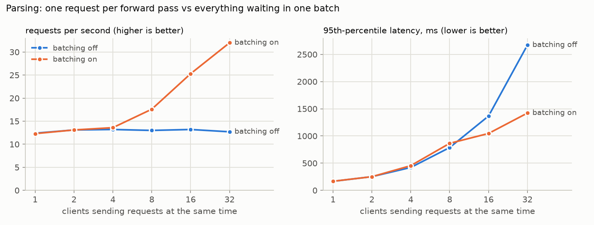

# M6 Ship: an HTTP API, a Docker image and a public demo

**Goal:** turn M3's language model and M5's parser into something other people can use (an API a
program can call, a container that runs anywhere, and a web page anyone can try), and understand
what changes when a model leaves the notebook: many requests at once, clients that disconnect,
more traffic than the machine can handle, and proving that the model being served is the model
that was evaluated.

**In short:** each model ships as a *bundle* (safetensors weights, config, tokenizer, checksums)
that reproduces its checkpoint exactly; on all 1,390 validation requests, the parser decoding
requests in shared batches writes exactly what M5's evaluation wrote (51.0% exact match). One
process serves both models behind worker threads: text streams over Server Sent Events, a full
queue answers HTTP 503 at once instead of letting waits grow without limit, a client that
disconnects stops its generation, and parse requests that arrive together share one forward pass:
2.5× the throughput at 32 clients on the MacBook. A Docker image runs the same service anywhere.
The public demo needs no server at all: free hosting on Hugging Face now means a *static* page, so
the visitor's browser downloads the weights and runs a JavaScript port of the model, checked against
PyTorch: the same token ids, logits within a few millionths, the same greedy text and the same
parses. Before showing the model to people we asked what it knows: for the capitals of 20 states and
countries it ranks the right city first only twice (chance level, and exactly the two facts its
training text states most often), so both demo pages say plainly that its fluent Hindi comes with
invented facts.

```
              ┌───────────────── python -m tinygpt.serve: one process, one port ─────────────────┐
 browser ───▶ │ /             Gradio demo ─┐                                                       │
 program ───▶ │ /v1/...       FastAPI    ──┼─ submit ─▶ queue (≤ 8)  ─▶ generate thread ─▶ gpt-llama │
 Prometheus ▶ │ /metrics                   └─ submit ─▶ queue (≤ 64) ─▶ parse thread ───▶ parser    │
              └─────────────────────────────────────────────────────────────────────────────────┘
 public demo (static Hugging Face Space): HTML + JavaScript; the visitor's browser fetches the weights
              from the model repo at a pinned commit and runs tokenizer, model and sampler itself
```

## 1. What is shipped (`src/tinygpt/bundle.py`, `scripts/export.py`)

| bundle | from | does | size | score |
|---|---|---|---:|---|
| `models/lm` | `checkpoints/gpt-llama/best.pt` (M3) | continues Hindi / Hinglish text | 55.2 MB | 0.733 bits per byte |
| `models/parser` | `runs/m5-annotated/full-long` (M5's best) | Hinglish request → intent + slots | 55.2 MB | 41.0% exact match (test) |

A bundle is a folder: `model.safetensors`, `config.json` (architecture, task, where the weights came
from, their scores, and the SHA256 of each file) and `tokenizer.json`. Loading checks the
checksums, builds the model from the config, and loads every weight strictly (nothing missing,
nothing extra).

**safetensors instead of `torch.save`.** A `.pt` file is a Python pickle, and unpickling can run
arbitrary code: loading a stranger's model is running a stranger's program. (`torch.load(...,
weights_only=True)`, which every loader in this repo uses, blocks that, if nobody forgets it.)
safetensors is a JSON header followed by raw tensor bytes: nothing to execute, readable by
memory mapping, readable from other languages, and the format the Hugging Face Hub expects.
Training checkpoints stay `.pt`: they also carry optimizer and random generator state.

**Tied weights are stored once.** The output layer and the token embedding are one matrix
(M3). `safetensors.torch.save_file` refuses tensors that share memory; `save_model` stores the
matrix once and `load_model` ties it again. 13,767,552 parameters × 4 bytes = 55.1 MB; M5's
`model.pt` was 67.7 MB because it held the matrix twice.

**Two checks** (`export.py`, on the CPU, where the service runs):
1. each bundle's logits equal its checkpoint's exactly (maximum difference 0.0);
2. the parser decoding validation requests in padded batches of 16, as the server does, writes the
   same text as decoding each alone, as M5's evaluation did: **1,390 / 1,390 identical**, exact
   match 51.0%, M5's validation score.

## 2. The engine (`src/tinygpt/serve/engine.py`)

Plain Python objects with no web code, so the server, the Space and the tests all run the same lines.

* **`TextGenerator.stream(prompt, params)`** yields `Piece`s of text, then one `Done` with the
  token count, why it stopped (`stop`: the model wrote `<|endoftext|>`; `length`; `cancelled`), the
  seed, the total time and the *time to first token*. It is M4's streaming loop: the prompt follows
  `<|endoftext|>`, the KV cache does one position per token, and an incremental UTF8 decoder holds
  back the bytes of a Devanagari letter split across two tokens. A request without a seed gets a
  random one, and the seed is returned: any answer can be generated again exactly.
* **`Parser.parse(requests)`** parses a whole list in one batch and returns, for each request, the
  tree the model wrote, the decoupled parse M5 scored, the intent, the slots, and the request's words
  grouped by slot (for highlighting). An empty or overlong request (> 64 tokens: 1 of Hinglish TOP's
  10,896 requests) gets an `error` in its own result instead of failing the batch it shares.

### Batching requests of different lengths: left padding (`models/gpt.py`)

M5 decoded thousands of known requests, so it could group them by length and never pad (M5,
decision 14). A server can't choose which requests arrive together. Shorter prompts are padded **on
the left**, so every row's next token goes into the same column:

```
row 0:  <pad> <pad> <eot>  timer    roko   =>       positions:  ·  ·  0  1  2  3
row 1:  <eot> mujhe Delhi  ka       weather =>      positions:  0  1  2  3  4  5
```

Three changes make a padded row compute what it computes alone:
1. **Mask:** no query attends to a padding key. A padding query attends only to itself: with
   nothing at all to attend to, softmax divides 0 by 0, and the NaN would spread into real tokens
   (they give padding weight 0, but 0 × NaN is NaN). The fused kernel happens to return zeros there;
   the hand written one returns NaN; the test catches it.
2. **Positions:** each row counts from its own first real token. (With RoPE only distances matter,
   so shifted positions would give the same scores in exact arithmetic, but counting per row makes
   the computation the same one, and keeps GPT 2's learned positions correct too.)
3. **Window:** a padded batch must fit in the 256 token window (prompt + 192 new tokens at most):
   restarting the cache would mean repadding every row.

Right padding doesn't work for generation: rows would end at different columns, and the new
tokens of a short row would land after its padding. `tests/test_kvcache.py` checks logits against
unpadded runs for both recipes and both attention implementations.

## 3. Many requests at once (`src/tinygpt/serve/worker.py`)

The server is asynchronous: one event loop handles every connection. A forward pass run inside
it would freeze all other clients while it computes. So **each model gets its own thread**, and
requests reach it through a queue:

* **Backpressure.** At most 8 generation and 64 parse requests wait. One more gets **HTTP 503 with
  `Retry-After: 1`** at once. An unbounded queue fails worse: by Little's law the wait is the queue
  length divided by the throughput, so a growing queue means waits that grow without limit, clients
  that time out, and work done for nobody.
* **Cancelling.** Each job carries a flag checked after every token. When a streaming client
  disconnects, FastAPI cancels the endpoint's generator; its `finally` sets the flag and the worker
  stops at the next token (`test_generate_worker_streams_and_cancels`; by hand: a stream closed
  after 3 tokens stopped after 4). A job cancelled while it still waits never starts.
* **Dynamic batching (parser).** The worker takes the job at the head of the queue *plus everything
  waiting behind it*, up to 16, and parses them in one padded batch. When the server is idle a
  request runs alone and at once; under load requests pile up while the model is busy, and batches
  grow by themselves. `TINYGPT_MAX_WAIT_MS` can also hold a batch open a few ms for company (NVIDIA
  Triton calls this `max_queue_delay_microseconds`); by default it doesn't wait.
* **Generation is not batched.** Streams have their own settings, lengths and arrival times. A
  batch that starts together runs until its longest member ends, while new requests wait, so
  serving systems batch *per step* instead: requests join and leave a running batch at every token
  (iteration level scheduling, Orca, OSDI 2022), with a KV cache allocated in pages so that sequences
  of any length fit (vLLM's PagedAttention, 2023). That is an exercise; here generation runs one
  stream at a time, and the load test shows what that costs.

Why threads work at all in Python: PyTorch releases the GIL inside its operations, so the event
loop keeps accepting and streaming while a matrix multiplication runs; only the short Python parts
of each step take turns.

## 4. The API (`src/tinygpt/serve/api.py`)

| | |
|---|---|
| `GET /health` | liveness: the process is up and the models are loaded |
| `GET /v1/info` | models, scores, limits, threads, load time, peak memory |
| `POST /v1/generate` | `{"prompt": ..., "max_new_tokens": ..., "temperature": ..., "top_k": ..., "top_p": ..., "min_p": ..., "repetition_penalty": ..., "seed": ...}` → the text, token count, finish reason, seed, timings |
| `POST /v1/generate/stream` | the same request; the answer as Server Sent Events |
| `POST /v1/parse` | `{"text": "kal subah 7 baje ka alarm laga do"}` → tree, intent, slots, spans, batch size |
| `GET /metrics` | Prometheus metrics |
| `GET /docs` | interactive documentation, generated from the code |
| `GET /` | the Gradio demo |

**Streaming** uses Server Sent Events: plain HTTP, readable with `curl -N` or a browser's
`EventSource`, with FastAPI's native support (since 0.135: correct framing, a keep alive comment
every 15 s, `Cache-Control: no-cache`, `X-Accel-Buffering: no` so a proxy doesn't hold it back):

```
event: token
data: {"text": " ke"}

event: token
data: {"text": " liye"}
...
event: done
data: {"tokens": 12, "finish_reason": "length", "seed": 2, "seconds": 0.157, "first_token_seconds": 0.044, "queue_seconds": 0.001}
```

A full queue must be a 503 **before** the stream's `200` is sent, so the streaming endpoint submits
its job in a dependency: dependencies run before the response starts.

**Validation** (Pydantic, from the type annotations): every limit is part of the schema
(`max_new_tokens` 1 to 256, temperature 0 to 2, prompts up to 2,000 characters, requests up to 300
characters and 64 tokens), so every request has a bounded cost. Unknown fields are refused
(`extra="forbid"`): a misspelt `tempreature` is a 422, not a silently ignored setting.

**Observability.** A pure ASGI middleware gives every request an id (`X-Request-ID`: the client's
if it sent one), one log line with status and milliseconds, and two metrics: requests by endpoint and
status, and latency to the *last* byte (Starlette's `BaseHTTPMiddleware` would stop the clock at the
first byte of a stream). The workers add queue wait, waiting jobs, 503s, parse batch sizes, tokens
generated, time to first token and finish reasons: the numbers that explain a latency.

**Settings** are environment variables (`TINYGPT_LM`, `TINYGPT_PARSER`, `TINYGPT_DEVICE`,
`TINYGPT_THREADS`, `TINYGPT_MAX_QUEUE_GENERATE`, `TINYGPT_MAX_QUEUE_PARSE`, `TINYGPT_MAX_BATCH`,
`TINYGPT_MAX_WAIT_MS`, `TINYGPT_UI`): the same image runs anywhere, configured from outside.
Models load in FastAPI's *lifespan*: once, when the server starts, not when the module is imported.

## 5. The service's demo page (`src/tinygpt/serve/ui.py`)

A Gradio page with three tabs: **Write** (prompt, streaming text, every M4 decoding knob, the
seed and speed of each answer), **Understand a request** (the request with its slots highlighted,
the intent, the tree) and **About** (the models and their scores). It is mounted at `/` of the
service, locally and in Docker. `build_ui` takes the two model calls as arguments, so the server
passes calls that go through its worker threads and `space/app.py` passes calls that run on a
borrowed ZeroGPU GPU: the page itself is the same code. The parse button uses Gradio's own
batching (`batch=True`), the same idea as the server's. The public demo (§8) is a different page
with the same three tabs, because it has no Python server behind it.

## 6. What the model knows (`scripts/probe_facts.py`)

The demo writes fluent Hindi full of invented facts. Continuing `भारत की राजधानी` ("the capital of
India") it wrote `… जेटन वाजिदा है` ("… is Jetan Wajida") and then drifted to an unrelated topic.
Two questions before putting that in front of people:

**Is it the serving code?** No. For the same prompt, settings and seed, the server writes exactly the
text that M4's `sampling.stream` writes from the original checkpoint (three seeds checked), and
the bundle's logits equal the checkpoint's (§1).

**Is it the model?** Asked directly, for the capitals of 20 Indian states and countries: after
`<place> की राजधानी`, the model's likelihood ranks all 20 cities.

| | the model | chance |
|---|---:|---:|
| right city ranked first | 2 of 20 | 1 of 20 |
| average rank of the right city | 9.7 | 10.5 |
| the other way round (`<city> ___ की राजधानी है`): right place first | 2 of 20 | 1 of 20 |
| greedy text names the right city | 1 of 20 | |
| samples name it: demo settings / temperature 0.7 + min p 0.1 | 4 / 6 of 200 | |

The two it gets right are the two facts its training text states most often: `भारत की राजधानी
दिल्ली` 23 times, `बिहार की राजधानी पटना` 15 times. The others appear 0 to 8 times, and for them the
model falls back on the most frequent city names (दिल्ली occurs 4,191 times in the training text,
पटना 867). Full table: [m6_facts.md](results/m6_facts.md).

**Why.** Facts live in the weights, and storing one takes many sightings: Allen Zhu & Li (2024)
measured that a language model stores at most about 2 bits of knowledge per parameter, and only when
each fact is seen about 1,000 times in training (with 100 sightings, about half as much). Our model
saw these facts at most ~40 times (1.8 passes over text that states them 0 to 23 times). What it saw
millions of times (word order, agreement, spelling, the shape of a Wikipedia article) is what it
learned. And it drifts after the first sentence because it continues a *document*: nothing taught it
to answer a question (that takes instruction tuning).

**What would fix it** (not M6's job): a much larger model trained on far more text, or handing the
model the facts in its prompt (retrieval augmented generation, project P5). Decoding can't: the
knowledge isn't there to be sampled; a more conservative sampler names the right city in 3% of
samples instead of 2%.

**What the demos do about it:** a note next to the text says it in one sentence, the About tab
shows the 2 of 20 result, and the default prompt is a topic (`हिन्दी भाषा`) rather than a question;
the capital prompt stays among the examples.

## 7. The image (`Dockerfile`)

```bash
docker build -t tinygpt .
docker run --rm -p 8000:8000 tinygpt          # http://localhost:8000
```

* **CPU only PyTorch** from PyTorch's CPU index. The default Linux wheel is built for NVIDIA GPUs:
  for 2.14.1 a 555 MB wheel plus NVIDIA's CUDA libraries (cuDNN alone is 553 MB): gigabytes this
  image would never use.
* **A lock file** (`requirements/serve.txt`, generated by `uv` from `requirements/serve.in`) pins
  every dependency, transitive ones included: the image built next month gets the same packages.
* **Layers from least to most often changed** (PyTorch, dependencies, our code, the models), so
  editing a `.py` file rebuilds only the last layers.
* **Non root user, health check, allowlist `.dockerignore`**: the build context is the five
  things the image needs, not the gigabytes in `data/` and `checkpoints/`.

**A bug the first build found.** The first container stopped at startup with `PermissionError` on
`/app/models/lm/model.safetensors`. `COPY` keeps each file's permissions from the build machine, and
safetensors writes its file as `rw-------` (owner only), so inside the image the weights belonged to
root and nobody else could read them, including the non root user the server runs as. The fix is in
two places: the Dockerfile sets the permissions while copying (`COPY --chmod=u=rwX,go=rX`, Dockerfile
syntax 1.14: everyone may read, only root may change), so the image no longer depends on how the
files looked on disk; and `save_bundle` makes the weights readable (`0644`) when it writes them, with
a test. Running as root would have hidden the bug, and given an attacker root inside the container.

## 8. The public demo: the model runs in the visitor's browser (`web/`, `scripts/deploy_hf.py`)

**Why no server.** Since July 2026, a Gradio or Docker Space on Hugging Face's free CPU hardware needs
a PRO plan ($9/month). A free account in good standing may host Gradio Spaces on ZeroGPU: this account
met the published conditions (verified email, older than 30 days), yet creating the Space was refused
with HTTP 402 "Payment Required". (`space/app.py` and `deploy_hf.py --kind zerogpu` stay for accounts
that have ZeroGPU.) What every account can host for free is a **static** Space: files, served as they
are. So the model has to run where the page runs: on the visitor's own processor.

```
 Space: static files                               model repo, at the commit named in config.js
   index.html  style.css  app.js  worker.js          lm/      config.json  tokenizer.json  model.safetensors (55 MB)
   tinygpt.js  config.js ── MODEL_BASE ─────────▶    parser/  config.json  tokenizer.json  model.safetensors (55 MB)
        │                                                │ downloaded once per browser, SHA256 checked,
        ▼                                                ▼ kept in Cache Storage
 the visitor's browser
   page thread: app.js (tabs, buttons, text)  ◀── messages ──▶  Web Worker: worker.js + tinygpt.js:
                                                                 tokenizer, forward pass, sampling, parser
```

**The port: `web/tinygpt.js`, 500 lines of plain JavaScript, no libraries.** Everything the Python
serving path does once the weights are loaded:

| JavaScript | ported from | what needed care |
|---|---|---|
| `normalize` | `text.py` | Python's `str.strip()` whitespace written out: JavaScript's differs |
| `Tokenizer` | `bpe.py` | the Devanagari aware regex rewritten for JavaScript's engine: case insensitive groups spelled out, possessive quantifiers made plain (nothing after them could match what they give back), and `\s` replaced by the 25 code points Python's `regex` module calls whitespace (JavaScript's `\s` adds U+FEFF and lacks U+0085) |
| `readSafetensors` | `bundle.py` | 8 bytes of header length, a JSON header, then raw float32, read in place as typed arrays; the tied matrix is stored once and used twice |
| `GPT.step` | `models/gpt.py` | one token at a time with a KV cache: RMSNorm, fused QKV, RoPE (its tables rounded to float32, as PyTorch computes them), causal attention, SwiGLU, the tied output layer. The prompt is fed one token at a time too: one code path |
| `filterLogits`, `sampleNext`, `iterTokens`, `stream` | `sampling.py`, `serve/engine.py` | the same filters in the same order, the same window restart, an incremental UTF8 decoder (`TextDecoder` with `stream: true`) |
| `Parser`, tree functions | `top.py`, `serve/engine.py` | the same prompt, greedy decoding and length limits; the decoupled parse; the request's words grouped by slot |

**Is it the same model?** Two levels of checks:
- `tests/test_web.py` (8 tests, a few seconds; skipped where Node.js isn't installed): tiny random
  models whose logits are scaled up, so that greedy choices are clear cut, check every piece against
  the Python code: token ids of tricky and 300 random multi script strings, logits against PyTorch,
  greedy text across a window restart, every sampling filter, the streamed text, the tree functions,
  the parser.
- `scripts/check_web.py`, with the real bundles → [m6_web.md](results/m6_web.md):

| check | result |
|---|---|
| tokenizer: every validation text and request encoded to the same token ids | 5,503 of 5,503 (113,053 tokens) |
| language model: largest logit difference after 10 prompts | 0.0000038 |
| language model: identical 60 token greedy continuations | 10 of 10 |
| parser: identical trees, first 200 validation requests | 200 of 200 |
| parser: exact match, browser / server | 49.0% / 49.0% |
| speed in Node.js, one thread | 35.1 ms per token |

Two things cannot be identical, by design:
- **Rounding.** JavaScript adds the same products in a different order than PyTorch's kernels, so
  logits differ in the sixth significant digit. A greedy choice could flip only where two tokens are
  that close; it never happened in these checks.
- **Random samples.** The browser draws from its own seeded generator (mulberry32), not PyTorch's,
  so one seed gives one text in the browser and another on the server. Each side is reproducible on
  its own: the same seed and settings write the same text.

**Running in a page.** The model runs in a **Web Worker**, a second thread: in the page's own thread,
a forward pass would freeze typing, scrolling and the Stop button for the whole answer. The worker
posts each piece of text as it is decoded and pauses for a zero delay message to itself after every
token, so that a Stop can arrive: the server's per token cancel flag again. The weights come from the
model repo at the commit in `config.js`; they are checked against the SHA256 in the bundle's
`config.json`, as `load_bundle` does, and only then kept in the browser's **Cache Storage**, so the
next visit starts in a fraction of a second without downloading 55 MB again. A damaged cached copy
fails the check and is downloaded again. A failed download says what failed (an HTTP status, the
network, the checksum) and how to recover. The parser's 55 MB are fetched only when its tab is opened.

**Cross origin downloads.** The page lives on the Space's own domain; the weights on huggingface.co,
which redirects to a file CDN. A browser lets a page read another origin's response only if the
response carries an `Access-Control-Allow-Origin` header (CORS), and the Hub sends it. The page makes
only plain GET requests (no `Range`, no custom headers), so the browser needs no preflight request.
The browser test below reproduces this (the page on one origin, the Hub answering with a redirect
to a second) and the failure without the header: a clear "the network request failed" instead of a
broken page.

**In a real browser**: `web/test/e2e.mjs` drives Chromium with Playwright (21 checks, ~30 s; needs
`npm install --no-save playwright` and `npx playwright install chromium` once): both models download
and become ready; the same seed writes the same text; Stop ends a text early; the parser's model is
fetched when its tab opens; an empty request gets a message; the About tab shows the bundles' scores;
the second visit loads from the cache; the page fits a phone; the download shows progress; a 404, a
damaged file and a network failure each get their own message; and the deployed setup works with
CORS and fails clearly without it.

**Speed.** The visitor's device sets it. In headless Chromium on the cloud machine used for testing,
a token takes ~37 ms at the start of a text and ~50 ms near the end of the 256 token window
(attention reads the whole cache); parsing a request takes 1 to 2 s. The server does 2.2 ms per token on
the MacBook's CPU (§9): PyTorch's kernels use vector instructions and several cores, the port plain
JavaScript on one. Fast enough to read along.

**Private by construction.** The Space has no server code, so what someone types on the page cannot be
sent anywhere, and the page says so.

**Deploying.** `python scripts/deploy_hf.py` uploads `models/` to the model repo, then the page to a
static Space with a generated `config.js` that names the commit just uploaded: new weights uploaded
later don't change the live demo until it is deployed again. The Space's settings live in its
`README.md` (`sdk: static`, `app_file: index.html`, the model it uses). `tests/test_deploy.py` checks
what would be uploaded, without uploading. To try the page locally: `python -m http.server` in the
repository and `http://localhost:8000/web/`; `web/config.js` points at `../models/` by default.

**The ZeroGPU version, for accounts that have it** (`space/`, `--kind zerogpu`). ZeroGPU lends a slice
of a GPU for the duration of each decorated call. `space/app.py` imports `spaces` before torch,
downloads the bundles, moves the models to `"cuda"` at startup (a stand in until a GPU is attached),
and decorates the two model calls with `@spaces.GPU`: each call runs in a forked process that gets a
real GPU, and its results come back pickled. The Space downloads the pinned model commit while it is
built (`preload_from_hub`), and pins PyTorch 2.13.0, the newest ZeroGPU supports.

## 9. Results

Measured on the MacBook Air (M2, 8 cores) with `bash scripts/run_m6.sh`, unless noted.

**The bundles** (`export.py`): logits equal to the checkpoints' (largest difference 0.0); batched
decoding writes what unbatched decoding writes on all 1,390 validation requests (exact match 51.0%).

**Load test** (`scripts/load_test.py`; client and server on the same Mac, server with 4 torch
threads; each row counts what finishes in a 10 second window) → [m6_load.md](results/m6_load.md):

| parse requests | 1 client | 4 | 8 | 16 | 32 |
|---|---:|---:|---:|---:|---:|
| requests/s, batching off | 12.4 | 13.2 | 13.0 | 13.2 | 12.7 |
| requests/s, batching on | 12.3 | 13.6 | 17.6 | 25.3 | **32.0** |
| mean batch, on | 1.0 | 2.5 | 6.2 | 11.2 | 16.0 |
| p50 latency, off / on (ms) | 72 / 72 | 290 / 281 | 611 / 408 | 1,202 / 633 | 2,512 / **912** |



- **Without batching, throughput is flat** at ~13 requests/s from the first client on: the parse
  thread is the bottleneck, so more clients only make a longer queue. The latency follows Little's
  law: 32 waiting requests ÷ 12.7 per second = 2.5 s, the measured median.
- **With batching, the same thread does 2.5× the work at 32 clients**, at a third of the latency.
  Batches grow exactly when a queue forms; at 1 to 2 clients nothing changes (batch size 1.0, the same
  72 ms): what not waiting for company buys.
- **Generation: ~455 tokens/s in total, whatever the number of clients**: one stream at a time.
  A 64 token stream takes 140 ms; the first token comes after 6 ms for one client but ~1 s with 8
  clients (980 ms median), which is the case for continuous batching (§3).
- **Overload:** 40 streams at once against a queue of 8: 9 served (the last one done after 1.3 s),
  31 refused with HTTP 503 in 22 ms (median): a fast "no" instead of a slow timeout.
- **Startup:** 1.7 s from launch to the first healthy response (imports and both models).

**Docker** (Docker Desktop on the Mac): the image is 1.89 GB and builds in about two minutes; the
container loads both models in 0.8 s, answers `/health` and parses requests, with 8 torch threads.

**What the model knows** (`probe_facts.py`): 2 of 20 capitals ranked first, chance level (§6).

**The browser version:** the same token ids, logits and parses as PyTorch (§8).

## 10. Decisions we made, and why

Each entry: what we chose → why → the alternatives and why we didn't pick them.

**1. Bundles: safetensors + config + tokenizer + checksums.** Why: no code runs on load; one folder
holds everything a model needs; the checksums and config make "which model is this, and is it
intact?" answerable. Not chosen: *`torch.save` checkpoints*: pickles; *ONNX*: a graph for other
runtimes, worth it to run without PyTorch, but our generation loop would have to be rewritten around
it (the browser demo runs the safetensors bundles directly: decision 22).

**2. Serve the fully fine tuned parser, not base + LoRA adapter.** Why: the best parser (41.0% vs
32.4% for the longer LoRA run), and memory is no constraint at 2 × 55 MB. Not chosen: *one base
model + adapters switched per request* (multi LoRA serving): the way to serve many tasks cheaply,
but here there is one task, and the parser's base (`gpt-llama-clean`) isn't the text model anyway.

**3. Serve `gpt-llama` for text.** Why: the model every M3 to M4 result describes. Not chosen:
`gpt-llama-clean`: the same model minus 8,095 Hinglish TOP lines in pretraining; it would matter
only if both tasks shared a base.

**4. CPU by default.** Why: M4 measured that for one stream at a time this model is faster on the
Mac's CPU than on its GPU (each step's fixed cost dominates), and most servers have no GPU. Not
chosen: *MPS*: only wins with large batches.

**5. FastAPI + uvicorn.** Why: request validation and OpenAPI docs come from type annotations,
asynchronous I/O holds many open streams cheaply, and SSE is built in. Not chosen: *Flask*: one
blocked worker thread per open stream; *a model server* (Triton, Ray Serve): it would do the
queueing and batching for us, and those are what this milestone is about.

**6. One worker thread per model, one process.** Why: the event loop never blocks; each model's work
is ordered, measurable and batchable. Not chosen: *the model inside the endpoint*: freezes every
connection; *a thread pool calling the model concurrently*: threads fight for the same cores, no
batching, no limit; *`uvicorn --workers N`*: N copies of the models and N separate queues, none
seeing the whole load; scale with whole replicas instead.

**7. A bounded queue and 503 + `Retry-After`.** Why: accepted requests keep a bounded wait; refused
ones learn it in milliseconds and can retry or go elsewhere. Not chosen: *an unbounded queue*: waits
grow without limit and requests time out after the work was done; *per client rate limits*:
complementary, needs client identities (exercise).

**8. Stop generating when the client leaves.** Why: an abandoned 256 token stream would otherwise
keep the only generation thread busy. Not chosen: *finish anyway*: simpler, wasted compute.

**9. Dynamic batching for parsing only, without waiting by default.** Why: parse requests are short,
greedy and independent, so sharing a forward pass is cheap; with no wait, an idle server answers at
once and batches form by themselves under load. Not chosen: *a fixed wait*: adds its delay to every
request at low load (available as `TINYGPT_MAX_WAIT_MS`); *batching generation*: needs continuous
batching to be worth it (§3).

**10. Left padding with a mask and per row positions.** Why: requests of any length can share a batch,
and the outputs are provably those of unbatched decoding (1,390 / 1,390). Not chosen: *M5's
equal length groups*: under real traffic, batches of one; *right padding*: rows would continue from
different columns.

**11. Server Sent Events, on a separate streaming endpoint.** Why: one way text over plain HTTP,
supported by browsers, curl and proxies, native in FastAPI. Not chosen: *WebSockets*: two way
machinery for a one way stream; *one endpoint with a `stream` flag* (OpenAI's style): two response
types for one route make its documentation vaguer.

**12. Strict request validation.** Why: every request's cost is bounded, and mistakes fail loudly.
Not chosen: *clamping out of range values*: surprising; *ignoring unknown fields* (the default):
typos silently change nothing.

**13. Every answer reports its seed.** Why: any output can be reproduced and debugged. Not chosen:
*hidden random seeds*: an odd answer could never be looked at again.

**14. Prometheus metrics, request ids, one log line per request.** Why: the standard pull format for
dashboards and alerts, and the metrics that explain latency (queue wait, batch size, time to first
token). Not chosen: *logs only*: hard to aggregate; *distributed tracing* (OpenTelemetry): more
setup than one service needs (exercise).

**15. Configuration from environment variables.** Why: one image for every environment. Not chosen:
*a config file inside the image*: a rebuild for every change.

**16. `python:3.12-slim`, CPU only PyTorch, a lock file, a non root user.** Why: a small Debian base
whose manylinux wheels install without compiling; Python 3.12 like the Space; no CUDA; the same
dependency versions on every build. Not chosen: *Alpine*: musl libc, for which PyTorch publishes no
wheels: it would have to be compiled; *a CUDA base image*: gigabytes for a CPU service; *a multi stage
build*: pays off when compiling, and we only install wheels.

**17. Models inside the image.** Why: an immutable artifact that starts offline, identical everywhere.
Not chosen: *download at startup*: every start depends on the network and waits for it; *a mounted
volume*: right for large or frequently updated models.

**18. The public demo: a static page that runs the model in the visitor's browser.** Why: free on
every account; nothing to start, sleep or scale: each visitor brings their own processor; and what
people type never leaves their device. The price: a 55 MB download per model on the first visit, the
visitor's device sets the speed, and a second implementation to keep identical to the first (hence
decision 25). Not chosen: *a ZeroGPU Space*: built first, but Hugging Face refused this account
(HTTP 402) though it met the published conditions; kept as `--kind zerogpu`; *a PRO Docker Space*
($9/month): would run this exact image, API included; *other free hosts for the Python service*:
small free tiers that sleep; *GitHub Pages*: would serve the same static page just as well, but the
Space sits next to the model repo and the Hub links the two.

**19. A model repo, and a demo pinned to one of its commits.** Why: the model card and weights live
in one place; the demo changes only when deployed (`config.js` names the commit). Not chosen:
*weights inside the Space repo*: no model card, 110 MB copied on every deploy; *following `main`*:
an upload would silently change the demo.

**20. Two demo pages: Gradio for the service, hand written HTML for the static Space.** Why: the
Gradio page comes almost free with the Python service (one file, calling the worker threads; the
same file serves a ZeroGPU Space, where each call runs in a forked process with a borrowed GPU and
Gradio's queue does the waiting). A static Space can't run it: Gradio needs a Python server, and in
the browser (Gradio Lite on Pyodide) there is no PyTorch. Not chosen: *the static page for everything*:
a page that makes the visitor's device do the work while a server sits idle.

**21. Measure what the model knows, and say it on the page.** Why: a demo that looks like it answers
questions misleads; a measured limit (2 of 20, chance level) is an honest, checkable result, and it
told us the wrong answers came from the model, not from the serving code. Not chosen: *quietly
dropping factual examples*: hides the behaviour from visitors who try their own; *changing the
decoding*: measured, it doesn't help (§6); *retrieval in the demo*: needs a fact store and a model
that can use its context (M5: few shot prompting scored 0%), which is P5's subject.

**22. A hand written JavaScript port, not a runtime.** Why: 500 lines with no dependencies, the same
structure as the Python code (so each function can be tested against its original), and the bundles
run as they are: fast enough for a 13.8M parameter model. Not chosen: *ONNX Runtime Web*: faster
(WebAssembly with vector instructions, threads, or WebGPU), but an ONNX export with the KV cache as
inputs and outputs, a runtime of several megabytes, and the tokenizer and sampler still to be written
in JavaScript; *Transformers.js*: the same runtime, plus converting our tokenizer and model to its
formats; *Python in the browser* (Pyodide, Gradio Lite): Pyodide has no PyTorch, so the model would
be rewritten anyway, behind a runtime of tens of megabytes; *WebGPU kernels*: the fastest for large
models, but at batch 1 and this size each step is too small to pay for the GPU round trip (M4 measured
the same on the Mac's GPU), and it would mean writing shaders.

**23. The model runs in a Web Worker.** Why: JavaScript in a page runs on the thread that draws it;
a forward pass there freezes the page, Stop included. Not chosen: *the page's thread, in slices*:
still janky, and every slice boundary is code; *a worker per model*: two threads that would compete
for the same cores, for no gain when one request runs at a time.

**24. Weights checked by SHA256 and kept in Cache Storage.** Why: the checksum in `config.json`
catches a truncated download or a damaged cached copy, as `load_bundle` does on the server; the cache
makes every visit after the first start at once. Not chosen: *the browser's HTTP cache*: may evict a
55 MB file at any time and can't be checked; *IndexedDB*: works, but Cache Storage stores the
download as it came, keyed by its URL, with less code; *no check*: a broken download would become a
model that writes nonsense.

**25. The port is tested against PyTorch, piece by piece and end to end.** Why: a port fails quietly:
a regex with a different idea of whitespace, a rounding difference in RoPE, a filter boundary off by
one; eyeballing output can't see that. Tiny random models with scaled up logits make every greedy
choice clear cut, so the tests compare exact token ids, not just closeness; the real bundles prove the
whole path, and a browser test the page around it. Not chosen: *testing only with the real model*: slow, and a failure doesn't say which
piece is wrong; *tolerance only comparisons*: a token that differs is a different text.

**26. The browser has its own random generator.** Why: mulberry32 is five lines and makes every seed
reproducible in the browser. Not chosen: *matching the server's samples*: reproducing PyTorch's
generator and `torch.multinomial` exactly in JavaScript is possible but brittle across PyTorch
versions, and nothing needs the two sides to sample the same text; greedy text is identical anyway.

## 11. Interview questions you should be able to answer

1. **Walk through a request.** Validated by Pydantic → submitted to the model's queue (or 503) →
   the worker thread runs the model → results cross back to the event loop with
   `call_soon_threadsafe` → JSON or SSE to the client.
2. **Why not call the model inside an `async def` endpoint?** It blocks the event loop: every other
   client freezes for the whole forward pass. CPU heavy work belongs in a thread (PyTorch releases
   the GIL inside ops) or a process.
3. **Latency vs throughput?** Latency: one request's wait. Throughput: requests per second.
   Batching raises throughput (one pass for many) and can raise latency (waiting for company, or
   for the longest member of the batch).
4. **Static, dynamic and continuous batching?** Static: a fixed batch runs to the end. Dynamic:
   requests that arrive close together are grouped. Continuous: the batch is rebuilt at every
   generated token, so finished sequences leave and new ones join: what LLM servers such as vLLM do.
5. **Why left padding for generation, and why the mask?** All rows must end in the same column so
   the next token of every row goes in one place; the mask keeps real tokens from attending to pads,
   and per row positions keep each row's positions what they would be alone.
6. **What is backpressure?** Telling clients to slow down instead of accepting work you can't do in
   time: a bounded queue and 503 + `Retry-After`. Little's law (L = λW) says a queue that grows means
   waits that grow.
7. **SSE or WebSockets for streaming tokens?** SSE: one way, plain HTTP, automatic reconnection in
   browsers, easy through proxies. WebSockets: two way, needed for interactive protocols, not for
   a stream of text.
8. **How do you stop work when a client disconnects?** Detect it (the framework cancels the
   streaming generator), set a flag, and check the flag between units of work (here, every token).
9. **How do you know the deployed model is the one you evaluated?** Same weights (checksums in the
   bundle, a pinned model commit), same numerics (bundle logits = checkpoint logits), same decoding
   (batched = unbatched on every validation request, same exact match).
10. **Why safetensors?** No code execution on load, fast memory mapped reads, language neutral.
11. **How would you scale this to 100× the traffic?** Stateless replicas behind a load balancer,
    autoscaled on queue depth or p95 latency; continuous batching on a GPU for generation; int8
    weights; a cache for repeated requests; streaming connections spread across replicas.
12. **What would you alert on?** p95/p99 latency, the 5xx and 503 rates, queue depth, time to first
    token, memory, and health check failures.
13. **Why not `uvicorn --workers 4`?** Four copies of every model in memory and four queues, each
    seeing a quarter of the load: batches shrink and one busy worker can't hand requests to an idle
    one. Use one worker per container and more containers.
14. **Liveness vs readiness?** Liveness: is the process alive (restart it if not). Readiness: can it
    take traffic now (route to it or not). Here models load before the server accepts connections, so
    `/health` is both; a server that loaded models lazily would need a separate readiness check.
15. **What makes a Docker image for ML big, and how do you shrink it?** The framework's GPU
    libraries; use CPU builds where there's no GPU, a slim base, no caches, only the files needed,
    and order layers so rebuilds are small.
16. **How can a web page run a neural network with no server, and what does it cost?** The weights
    are just numbers: the page downloads them once (55 MB here, then cached) and runs the forward pass
    itself: in JavaScript, WebAssembly or WebGPU, inside a Web Worker. Gains: no hosting bill, no cold
    start, it scales with the visitors, and their text stays on their device. Costs: the first
    download, the visitor's device sets the speed (~40 ms per token here vs 2.2 ms on the server), and
    a second implementation that must stay identical to the first.
17. **Why does a small language model state wrong facts so fluently?** Fluency comes from patterns
    seen millions of times; a fact must be seen many times (~1,000 for full capacity) and costs
    parameters to store (~2 bits each; Allen Zhu & Li, 2024). At 13.8M parameters, with facts seen
    a few dozen times at most, it learned the language, not the facts: 2 of 20 capitals, chance
    level. First rule out the serving code (same output as the checkpoint), then measure the model.
18. **How do you check that a port of a model to another language is right?** Feed both the same
    inputs and compare at every level: token ids (exactly), logits (to a tolerance: floating point
    sums depend on order), greedy text and task outputs (exactly), the task's score. Test each piece
    on tiny random models with large logits, so a greedy choice can't hinge on rounding, then the real
    model end to end.
19. **What is CORS, and why did the page need it?** A browser lets a page read a response from
    another origin only if the response allows it (`Access-Control-Allow-Origin`). The page lives on
    the Space's domain and reads the weights from huggingface.co and its CDN, which send that header.
    Plain GETs need no preflight; custom headers or `Range` requests would.
20. **Why a Web Worker?** JavaScript in a page runs on the thread that draws the page and handles
    input; a long computation there freezes both. A worker is a second thread that talks to the page
    by messages: here, text pieces out, Stop in.
21. **How does ZeroGPU work, and what does it cost the user?** A GPU is attached only while a
    decorated function runs, in a forked process, then released; visitors share daily quotas and may
    queue for a GPU, and the first call after idle pays the attach time.

## 12. Try it yourself

- **Continuous batching** for generation: one decode step for all active streams, per row sampling
  settings, streams joining and leaving at every token. Then rerun the load test.
- **int8 weights** (dynamic quantization of the linear layers) for CPU serving: latency, memory, and
  what it does to bits per byte and exact match.
- **A faster browser version:** the matrix vector products in WebAssembly with vector instructions,
  or int8 weights (a quarter of the download and of the memory read per token): measure ms per token
  and the logit difference against PyTorch.
- **The prompt in one pass in the browser:** all prompt positions in one step (matrix matrix
  products) instead of one token at a time: a shorter wait for the first token after long prompts.
- **API keys and per key rate limits**, returning 429 when a key exceeds its share.
- **A separate readiness endpoint** that reports "not ready" while models load lazily, and the
  Kubernetes probes that use both (P7).
- **Load test from another machine** over the network, and an autoscaling rule from the metrics.
