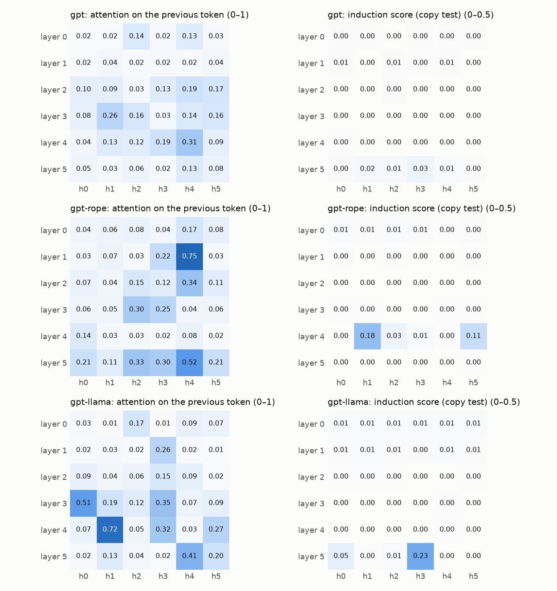

# Attention-head census

Measured on 16 windows of Hindi Wikipedia (queries with ≥ 16 tokens of history) and, for the induction score, on 100 random tokens shown twice. Shares are averages of attention weights.

| model | strongest previous-token head | heads above 50% | strongest induction head | mean look-back, first layer → last |
|---|---|---:|---|---|
| gpt | 31% (layer 4, head 4) | 0 | 3% (layer 5, head 3) | 41 → 50 → 17 → 10 → 13 → 31 tokens |
| gpt-rope | 75% (layer 1, head 4) | 2 | 18% (layer 4, head 1) | 45 → 27 → 19 → 24 → 29 → 13 tokens |
| gpt-llama | 72% (layer 4, head 1) | 2 | 23% (layer 5, head 3) | 59 → 46 → 26 → 14 → 18 → 22 tokens |

## Every head

### gpt

| layer.head | previous | self | first | look-back | induction |
|---|---:|---:|---:|---:|---:|
| 0.0 | 0.02 | 0.02 | 0.02 | 60.1 | 0.00 |
| 0.1 | 0.02 | 0.02 | 0.01 | 44.9 | 0.00 |
| 0.2 | 0.14 | 0.04 | 0.01 | 22.0 | 0.00 |
| 0.3 | 0.02 | 0.01 | 0.01 | 43.1 | 0.00 |
| 0.4 | 0.13 | 0.02 | 0.01 | 29.3 | 0.00 |
| 0.5 | 0.03 | 0.02 | 0.01 | 44.5 | 0.00 |
| 1.0 | 0.02 | 0.01 | 0.02 | 71.3 | 0.01 |
| 1.1 | 0.04 | 0.04 | 0.02 | 27.0 | 0.00 |
| 1.2 | 0.02 | 0.02 | 0.03 | 63.4 | 0.01 |
| 1.3 | 0.02 | 0.02 | 0.02 | 44.4 | 0.00 |
| 1.4 | 0.02 | 0.01 | 0.02 | 67.5 | 0.01 |
| 1.5 | 0.04 | 0.03 | 0.01 | 25.2 | 0.00 |
| 2.0 | 0.10 | 0.07 | 0.00 | 9.0 | 0.00 |
| 2.1 | 0.09 | 0.06 | 0.00 | 10.1 | 0.00 |
| 2.2 | 0.03 | 0.03 | 0.04 | 66.9 | 0.00 |
| 2.3 | 0.13 | 0.10 | 0.00 | 6.1 | 0.00 |
| 2.4 | 0.19 | 0.13 | 0.00 | 4.9 | 0.00 |
| 2.5 | 0.17 | 0.13 | 0.00 | 4.6 | 0.00 |
| 3.0 | 0.08 | 0.08 | 0.00 | 10.2 | 0.00 |
| 3.1 | 0.26 | 0.13 | 0.00 | 4.2 | 0.00 |
| 3.2 | 0.16 | 0.15 | 0.00 | 5.0 | 0.00 |
| 3.3 | 0.03 | 0.04 | 0.01 | 27.4 | 0.00 |
| 3.4 | 0.14 | 0.10 | 0.00 | 5.9 | 0.00 |
| 3.5 | 0.16 | 0.15 | 0.00 | 5.0 | 0.00 |
| 4.0 | 0.04 | 0.04 | 0.00 | 31.1 | 0.00 |
| 4.1 | 0.13 | 0.10 | 0.00 | 8.2 | 0.00 |
| 4.2 | 0.12 | 0.06 | 0.00 | 19.3 | 0.00 |
| 4.3 | 0.19 | 0.11 | 0.00 | 5.7 | 0.00 |
| 4.4 | 0.31 | 0.09 | 0.00 | 6.0 | 0.00 |
| 4.5 | 0.09 | 0.08 | 0.00 | 10.3 | 0.00 |
| 5.0 | 0.05 | 0.06 | 0.00 | 21.3 | 0.00 |
| 5.1 | 0.03 | 0.04 | 0.01 | 39.8 | 0.02 |
| 5.2 | 0.06 | 0.06 | 0.00 | 29.8 | 0.01 |
| 5.3 | 0.02 | 0.04 | 0.01 | 42.5 | 0.03 |
| 5.4 | 0.13 | 0.06 | 0.00 | 29.8 | 0.01 |
| 5.5 | 0.08 | 0.10 | 0.00 | 22.6 | 0.00 |

### gpt-rope

| layer.head | previous | self | first | look-back | induction |
|---|---:|---:|---:|---:|---:|
| 0.0 | 0.04 | 0.05 | 0.01 | 51.8 | 0.01 |
| 0.1 | 0.06 | 0.03 | 0.01 | 52.3 | 0.01 |
| 0.2 | 0.08 | 0.04 | 0.01 | 52.7 | 0.01 |
| 0.3 | 0.04 | 0.03 | 0.01 | 46.8 | 0.01 |
| 0.4 | 0.17 | 0.04 | 0.00 | 31.4 | 0.00 |
| 0.5 | 0.08 | 0.03 | 0.00 | 34.8 | 0.00 |
| 1.0 | 0.03 | 0.01 | 0.00 | 36.2 | 0.00 |
| 1.1 | 0.07 | 0.03 | 0.00 | 13.7 | 0.00 |
| 1.2 | 0.03 | 0.02 | 0.01 | 43.8 | 0.00 |
| 1.3 | 0.22 | 0.05 | 0.00 | 27.2 | 0.00 |
| 1.4 | 0.75 | 0.07 | 0.00 | 5.6 | 0.00 |
| 1.5 | 0.03 | 0.03 | 0.01 | 36.6 | 0.00 |
| 2.0 | 0.07 | 0.03 | 0.00 | 25.4 | 0.00 |
| 2.1 | 0.04 | 0.03 | 0.00 | 17.1 | 0.00 |
| 2.2 | 0.15 | 0.04 | 0.00 | 22.4 | 0.00 |
| 2.3 | 0.12 | 0.06 | 0.00 | 23.1 | 0.00 |
| 2.4 | 0.34 | 0.09 | 0.00 | 6.4 | 0.00 |
| 2.5 | 0.11 | 0.05 | 0.00 | 17.7 | 0.00 |
| 3.0 | 0.06 | 0.04 | 0.00 | 28.2 | 0.00 |
| 3.1 | 0.05 | 0.04 | 0.01 | 28.8 | 0.00 |
| 3.2 | 0.30 | 0.09 | 0.00 | 11.1 | 0.00 |
| 3.3 | 0.25 | 0.08 | 0.00 | 9.4 | 0.00 |
| 3.4 | 0.04 | 0.02 | 0.01 | 41.2 | 0.00 |
| 3.5 | 0.06 | 0.04 | 0.00 | 25.8 | 0.00 |
| 4.0 | 0.14 | 0.04 | 0.00 | 15.6 | 0.00 |
| 4.1 | 0.03 | 0.03 | 0.01 | 37.3 | 0.18 |
| 4.2 | 0.03 | 0.04 | 0.01 | 27.6 | 0.03 |
| 4.3 | 0.02 | 0.02 | 0.01 | 35.8 | 0.01 |
| 4.4 | 0.08 | 0.04 | 0.00 | 20.2 | 0.00 |
| 4.5 | 0.02 | 0.03 | 0.01 | 38.3 | 0.11 |
| 5.0 | 0.21 | 0.07 | 0.00 | 8.3 | 0.00 |
| 5.1 | 0.11 | 0.05 | 0.00 | 16.6 | 0.00 |
| 5.2 | 0.33 | 0.11 | 0.00 | 12.6 | 0.00 |
| 5.3 | 0.30 | 0.13 | 0.00 | 11.1 | 0.00 |
| 5.4 | 0.52 | 0.12 | 0.00 | 6.2 | 0.00 |
| 5.5 | 0.21 | 0.07 | 0.01 | 24.9 | 0.00 |

### gpt-llama

| layer.head | previous | self | first | look-back | induction |
|---|---:|---:|---:|---:|---:|
| 0.0 | 0.03 | 0.03 | 0.01 | 61.9 | 0.01 |
| 0.1 | 0.01 | 0.03 | 0.01 | 65.6 | 0.01 |
| 0.2 | 0.17 | 0.03 | 0.01 | 47.3 | 0.01 |
| 0.3 | 0.01 | 0.02 | 0.01 | 65.4 | 0.01 |
| 0.4 | 0.09 | 0.05 | 0.01 | 56.6 | 0.01 |
| 0.5 | 0.07 | 0.03 | 0.01 | 55.3 | 0.01 |
| 1.0 | 0.02 | 0.02 | 0.01 | 50.4 | 0.01 |
| 1.1 | 0.03 | 0.02 | 0.01 | 51.1 | 0.01 |
| 1.2 | 0.02 | 0.02 | 0.01 | 48.5 | 0.01 |
| 1.3 | 0.26 | 0.03 | 0.00 | 28.6 | 0.00 |
| 1.4 | 0.02 | 0.02 | 0.01 | 45.6 | 0.01 |
| 1.5 | 0.01 | 0.01 | 0.01 | 49.7 | 0.01 |
| 2.0 | 0.09 | 0.02 | 0.01 | 26.8 | 0.00 |
| 2.1 | 0.04 | 0.02 | 0.00 | 23.7 | 0.00 |
| 2.2 | 0.06 | 0.03 | 0.01 | 32.0 | 0.00 |
| 2.3 | 0.15 | 0.05 | 0.00 | 14.2 | 0.00 |
| 2.4 | 0.09 | 0.03 | 0.00 | 18.8 | 0.00 |
| 2.5 | 0.02 | 0.02 | 0.01 | 39.7 | 0.00 |
| 3.0 | 0.51 | 0.05 | 0.00 | 13.5 | 0.00 |
| 3.1 | 0.19 | 0.06 | 0.00 | 9.8 | 0.00 |
| 3.2 | 0.12 | 0.03 | 0.00 | 9.9 | 0.00 |
| 3.3 | 0.35 | 0.05 | 0.00 | 5.7 | 0.00 |
| 3.4 | 0.07 | 0.03 | 0.00 | 23.0 | 0.00 |
| 3.5 | 0.09 | 0.04 | 0.00 | 19.1 | 0.00 |
| 4.0 | 0.07 | 0.03 | 0.00 | 20.9 | 0.00 |
| 4.1 | 0.72 | 0.06 | 0.00 | 10.3 | 0.00 |
| 4.2 | 0.05 | 0.02 | 0.00 | 23.5 | 0.00 |
| 4.3 | 0.32 | 0.05 | 0.00 | 6.0 | 0.00 |
| 4.4 | 0.03 | 0.03 | 0.00 | 35.5 | 0.00 |
| 4.5 | 0.27 | 0.06 | 0.00 | 12.8 | 0.00 |
| 5.0 | 0.02 | 0.02 | 0.01 | 32.6 | 0.05 |
| 5.1 | 0.13 | 0.05 | 0.00 | 12.8 | 0.00 |
| 5.2 | 0.04 | 0.04 | 0.00 | 24.7 | 0.01 |
| 5.3 | 0.02 | 0.02 | 0.01 | 43.5 | 0.23 |
| 5.4 | 0.41 | 0.08 | 0.00 | 7.3 | 0.00 |
| 5.5 | 0.20 | 0.07 | 0.00 | 12.2 | 0.00 |
