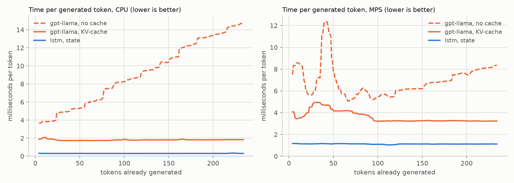

# M4 — generation speed

Greedy, 240 new tokens after a prompt of 8 tokens, batch 1. Each token is timed from the previous one (choosing a token waits for the GPU, so the times are real). tokens/s = tokens ÷ total time; first/last 20 = median time of those tokens; the chart shows the median of every 9 neighbouring tokens. Raw timings: `m4_generation.json` (redraw with `--replot`).

| model | device | prompt (ms) | tokens/s | ms/token, first 20 | ms/token, last 20 | slowest token (ms) | tokens/s, batch of 16 |
|---|---|---:|---:|---:|---:|---:|---:|
| gpt-llama, no cache | cpu | 3.9 | 108.4 | 3.8 | 14.5 | 14.9 | 169 |
| gpt-llama, KV-cache | cpu | 4.4 | 549.9 | 1.9 | 1.8 | 3.1 | 3314 |
| gpt-llama, no cache | mps | 4.4 | 140.3 | 8.3 | 8.2 | 32.9 | 335 |
| gpt-llama, KV-cache | mps | 3.8 | 274.1 | 3.6 | 3.2 | 9.9 | 3415 |
| lstm, state | cpu | 1.5 | 3200.7 | 0.3 | 0.3 | 0.4 | 13035 |
| lstm, state | mps | 2.4 | 881.7 | 1.1 | 1.1 | 1.3 | 12406 |

