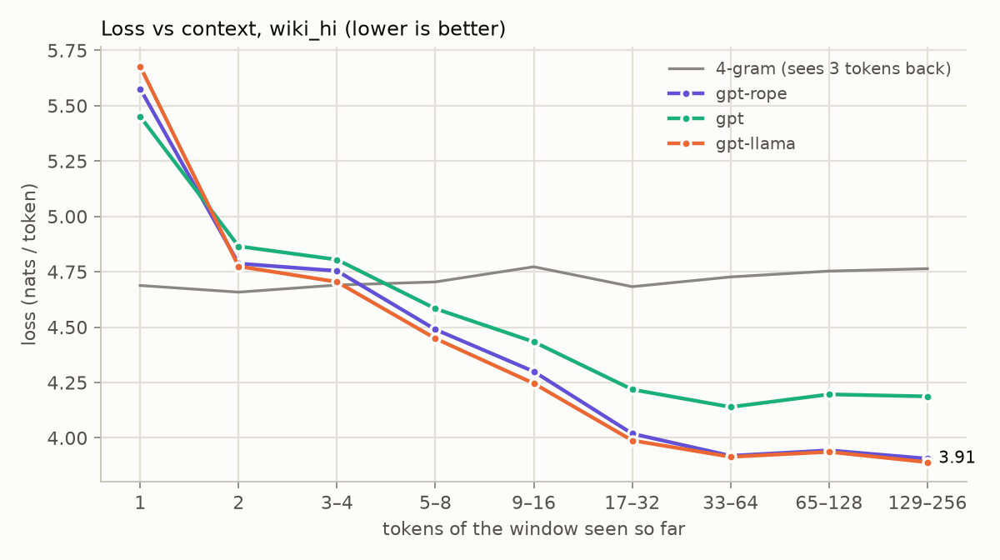

# Where each model wins

Bits per byte on the validation set, by data source (lower is better). The unseen column is the share of the source's 4-grams (a token and the 3 before it) that never occur in the training data: low means the text repeats training phrases.

| source | tokens | bytes/token | 4-grams unseen in training | 4-gram | gpt-rope | gpt | gpt-llama |
|---|---:|---:|---:|---:|---:|---:|---:|
| wiki_hi | 79,649 | 8.27 | 68.6% | 0.829 | 0.691 | 0.735 | 0.689 |
| findnitai | 12,332 | 3.32 | 24.6% | 1.233 | 1.325 | 1.405 | 1.303 |
| hinglish_top | 7,872 | 3.73 | 2.4% | 0.746 | 0.949 | 1.012 | 0.931 |

## Mixing gpt-rope with the 4-gram

p = w · p_gpt-rope + (1 − w) · p_4-gram, for every token; the weight w is chosen on validation.

| weight of gpt-rope | Hindi | Hinglish | all |
|---:|---:|---:|---:|
| 0.0 | 0.829 | 1.029 | 0.848 |
| 0.1 | 0.749 | 0.984 | 0.772 |
| 0.2 | 0.722 | 0.970 | 0.746 |
| 0.3 | 0.705 | 0.964 | 0.730 |
| 0.4 | 0.692 | 0.962 | 0.718 |
| 0.5 | 0.682 | 0.965 | 0.709 |
| 0.6 | 0.675 | 0.973 | 0.704 |
| **0.7** | 0.671 | 0.985 | 0.701 |
| 0.8 | 0.669 | 1.006 | 0.702 |
| 0.9 | 0.671 | 1.042 | 0.707 |
| 1.0 | 0.691 | 1.168 | 0.737 |

## Loss vs context (wiki_hi)

Mean loss (nats/token) by how many tokens of its 256-token window a model had read when predicting. The 4-gram always looks 3 tokens back, so it barely changes.

| tokens seen | 4-gram | gpt-rope | gpt | gpt-llama |
|---:|---:|---:|---:|---:|
| 1 | 4.688 | 5.576 | 5.451 | 5.678 |
| 2 | 4.658 | 4.787 | 4.865 | 4.775 |
| 3–4 | 4.690 | 4.754 | 4.805 | 4.704 |
| 5–8 | 4.704 | 4.489 | 4.583 | 4.449 |
| 9–16 | 4.773 | 4.300 | 4.434 | 4.246 |
| 17–32 | 4.683 | 4.019 | 4.218 | 3.988 |
| 33–64 | 4.727 | 3.919 | 4.139 | 3.914 |
| 65–128 | 4.753 | 3.944 | 4.196 | 3.937 |
| 129–256 | 4.764 | 3.906 | 4.187 | 3.890 |

## Copying a random sequence

Loss (nats/token) on 32 sequences of 100 random tokens, each shown twice. The first copy can only be guessed; the second can be copied from the first by a model that can look back that far.

| model | 1st copy | 2nd copy |
|---|---:|---:|
| gpt-rope | 13.37 | 12.38 |
| gpt | 13.26 | 12.97 |
| gpt-llama | 13.19 | 11.90 |
