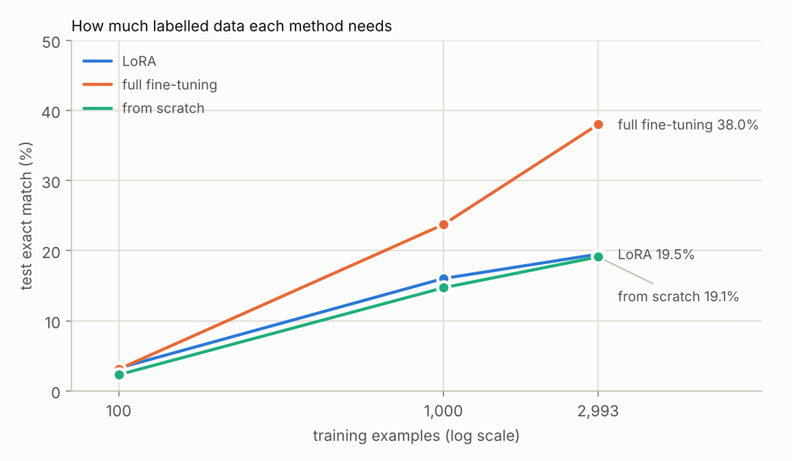
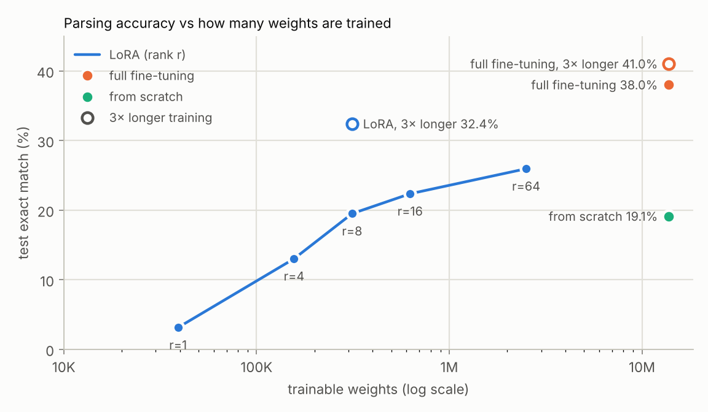

# M5 — fine-tuning results

Task: Hinglish-TOP semantic parsing (2,993 training, 1,390 validation, 6,513 test requests). Base model: `gpt-llama-clean` (M3's Llama recipe, pretrained without the validation and test requests). What the model writes: the request annotated with brackets (scored decoupled). The output format and the learning rates were chosen on validation exact match; everything else is on the test set.

## Methods

| method | trainable weights | to store per task | val exact match | test exact match | intent | slot F1 | valid trees | general text after (bits/byte) | training |
|---|---:|---:|---:|---:|---:|---:|---:|---:|---:|
| lookup table: the parse of the same training request, if there is one | 0 | — | — | 9.3% | 9.7% | 11.0% | 9.8% | — | — |
| always the most common intent ([IN:GET_WEATHER ]) | 0 | — | — | 0.8% | 13.9% | 0.0% | 100.0% | — | — |
| few-shot: 3 solved examples in the prompt | 0 | — | 0.0% | **0.0%** | 0.0% | 0.0% | 0.0% | 0.731 | — |
| from scratch (random weights) | 13.8M | 55.1 MB | 29.0% | **19.1%** | 80.5% | 28.1% | 91.8% | 2.001 | 2.3 min |
| full fine-tuning | 13.8M | 55.1 MB | 49.0% | **38.0%** | 83.2% | 53.4% | 91.6% | 1.519 | 2.3 min |
| LoRA r=8, attention + MLP | 313K | 1.3 MB | 28.4% | **19.5%** | 77.5% | 29.9% | 89.9% | 0.873 | 2.2 min |
| LoRA r=8, attention only | 111K | 442 KB | 8.1% | **5.1%** | 65.4% | 13.7% | 82.0% | 0.783 | 1.6 min |

To store per task: the trained weights at 4 bytes each (LoRA: the adapter; the others: a whole model). General text: bits per byte on M1's validation text (base model: 0.731); with LoRA, removing the adapter gives the base model back exactly.

## Learning rates (validation exact match)

| method | 3e-5 | 1e-4 | 3e-4 | 1e-3 | 3e-3 | 1e-2 |
|---|---:|---:|---:|---:|---:|---:|
| LoRA | — | — | — | 11.2% | **28.4%** | 24.2% |
| full fine-tuning | — | 27.8% | 44.9% | **49.0%** | — | — |
| from scratch | — | — | 21.9% | **29.0%** | 6.7% | — |

## LoRA: rank and layers

| rank | layers | trainable weights | share of the model | adapter (fp32) | test exact match | slot F1 |
|---:|---|---:|---:|---:|---:|---:|
| 1 | attention + MLP | 39,168 | 0.28% | 157 KB | 3.1% | 10.4% |
| 4 | attention + MLP | 156,672 | 1.14% | 627 KB | 13.0% | 22.5% |
| 8 | attention + MLP | 313,344 | 2.28% | 1.3 MB | 19.5% | 29.9% |
| 16 | attention + MLP | 626,688 | 4.55% | 2.5 MB | 22.4% | 33.2% |
| 64 | attention + MLP | 2,506,752 | 18.21% | 10.0 MB | 25.9% | 38.6% |
| 8 | attention only | 110,592 | 0.80% | 442 KB | 5.1% | 13.7% |

## What the model writes (600 steps; learning rate chosen per format on validation)

| output | example | LoRA | full fine-tuning | from scratch |
|---|---|---:|---:|---:|
| annotated | `[in:create_alarm [sl:date_time do ghante ke liye ] alarm set kardo ]` | 19.5% test (28.4% val) | 38.0% test (49.0% val) | 19.1% test (29.0% val) |
| decoupled | `[in:create_alarm [sl:date_time do ghante ke liye ] ]` | 19.1% test (27.7% val) | 32.6% test (42.4% val) | 18.7% test (27.8% val) |

## Longer training (3× the steps)

| method | 600 steps | 1,800 steps | best step |
|---|---:|---:|---:|
| LoRA | 19.5% | 32.4% | 1,800 |
| full fine-tuning | 38.0% | 41.0% | 1,800 |

## Run-to-run noise (LoRA r=8, three seeds)

| seed | 0 | 1 | 2 | mean | max − min |
|---|---:|---:|---:|---:|---:|
| test exact match | 19.5% | 19.5% | 19.8% | 19.6% | 0.3 points |

## How the model writes labels (LoRA r=8)

| labels | example | tokens per parse | test exact match | training |
|---|---|---:|---:|---:|
| upper (as in the dataset) | `[IN:CREATE_ALARM` | 59.6 | 16.4% | 2.6 min |
| lower case | `[in:create_alarm` | 42.8 | 19.5% | 2.2 min |

## How much labelled data (test exact match)

| method | 100 examples | 1,000 examples | 2,993 examples |
|---|---:|---:|---:|
| LoRA | 3.3% | 16.0% | 19.5% |
| full fine-tuning | 3.1% | 23.7% | 38.0% |
| from scratch | 2.3% | 14.7% | 19.1% |

## Did reading the test requests during pretraining help?

| base model | pretraining saw the test requests | LoRA test exact match | full fine-tuning test exact match | base loss on test requests | base loss on training requests |
|---|---|---:|---:|---:|---:|
| gpt-llama (M3) | yes (not their parses) | 19.2% | 37.5% | 3.222 | 2.669 |
| gpt-llama-clean | no | 19.5% | 38.0% | 3.457 | 2.759 |

Loss: nats per token of each request read as a new document. Both models read the training requests, so the last column is the control.

## Requests already in the training set

26% of validation requests also appear in training, against 9.8% of test requests — one reason validation scores run higher than test scores.

| method | test requests also in training (exact match) | new requests (exact match) |
|---|---:|---:|
| LoRA | 67.1% (639) | 14.3% (5,874) |
| full fine-tuning | 94.5% (639) | 31.9% (5,874) |
| from scratch | 78.2% (639) | 12.7% (5,874) |

## By domain (test exact match)

| method | alarm | event | messaging | music | navigation | reminder | timer | weather |
|---|---:|---:|---:|---:|---:|---:|---:|---:|
| LoRA | 33.4% | 8.0% | 5.1% | 12.0% | 7.3% | 2.4% | 39.4% | 36.2% |
| full fine-tuning | 55.9% | 29.1% | 25.9% | 36.2% | 22.8% | 16.6% | 48.6% | 57.1% |
| from scratch | 34.6% | 4.8% | 4.9% | 19.5% | 4.6% | 1.2% | 38.5% | 32.8% |

## What LoRA gets wrong (test)

| error | share of errors |
|---|---:|
| right intent, a slot missing, extra or mislabelled | 41% (2,165) |
| wrong intent | 24% (1,258) |
| right intent and slots, wrong words in a slot | 22% (1,159) |
| not a valid tree | 13% (661) |

Examples:

- *right intent and slots, wrong words in a slot* — `Kya hawaii me raining ho rahi hai?`
  - gold: `[IN:GET_WEATHER [SL:LOCATION hawaii ] [SL:WEATHER_ATTRIBUTE raining ] ]`
  - LoRA: `[IN:GET_WEATHER [SL:LOCATION hawaii ] [SL:WEATHER_ATTRIBUTE cutesting ] ]`
- *right intent, a slot missing, extra or mislabelled* — `Mere liye reminder set karo to wake up at 6:30 am tomorrow.`
  - gold: `[IN:CREATE_REMINDER [SL:PERSON_REMINDED Mere ] [SL:TODO wake up ] [SL:DATE_TIME at 6:30 am tomorrow. ] ]`
  - LoRA: `[IN:CREATE_REMINDER [SL:PERSON_REMINDED Mere ] [SL:DATE_TIME to wake up ] ]`
- *right intent, a slot missing, extra or mislabelled* — `Killswitch engaged ka pehla album play kariye`
  - gold: `[IN:PLAY_MUSIC [SL:MUSIC_TYPE album ] ]`
  - LoRA: `[IN:PLAY_MUSIC [SL:MUSIC_ARTIST_NAME Kent rokey ] [SL:MUSIC_TYPE song ] ]`
- *wrong intent* — `Today ki UV rating kya hai?`
  - gold: `[IN:GET_WEATHER [SL:DATE_TIME Today ] [SL:WEATHER_ATTRIBUTE UV rating ] ]`
  - LoRA: `[IN:GET_EVENT [SL:DATE_TIME Today ] [SL:CATEGORY_EVENT Competers ] ]`
- *wrong intent* — `Waukegan ke Greenbay Road par sab se halka traffic kab hai`
  - gold: `[IN:UNSUPPORTED_NAVIGATION ]`
  - LoRA: `[IN:GET_INFO_TRAFFIC [SL:LOCATION Waukee ] [SL:DESTINATION [IN:GET_LOCATION [SL:CATEGORY_LOCATION Green ] ] ] [SL:CATEGORY_EVENT aage ] ]`
- *not a valid tree* — `Mujhe saare events ki list do jo Phoneix area me hone wale hai this month`
  - gold: `[IN:GET_EVENT [SL:LOCATION Phoneix ] [SL:DATE_TIME this month ] ]`
  - LoRA: `[IN:GET_EVENT Mujhe [SL:DATE_TIME Mujhe ] [SL:LOCATION [IN:GET_LOCATION [SL:CATEGORY_LOCATION Mere ] [SL:CATEGORY_EVENT concerts ] ] ]`
- *not a valid tree* — `Mere work friends ke sath my lunch gathering ka mera next alert kab he`
  - gold: `[IN:GET_REMINDER_DATE_TIME [SL:TODO [IN:GET_TODO [SL:ATTENDEE [IN:GET_CONTACT [SL:CONTACT_RELATED Mere ] [SL:MUTUAL_EMPLOYER work ] [SL:TYPE_RELATION friends ] ] ] [SL:TODO my lunch gathering ] ] ] [SL:PERSON_REMINDED mera ] [SL:ORDINAL next ] ]`
  - LoRA: `[IN:GET_REMINDER [SL:PERSON_REMINDED Mere ] [SL:TODO work ] ke sath [SL:DATE_TIME kal ] [SL:TODO [IN:GET_TODO [SL:DATE_TIME is weekend ] ] ] ke sath [SL:TODO dinner ] ] ]`
- *right intent and slots, wrong words in a slot* — `Jennifer ko bolo ke I will meet her at the Friendship Festival .`
  - gold: `[IN:SEND_MESSAGE [SL:RECIPIENT Jennifer ] [SL:CONTENT_EXACT I will meet her at the Friendship Festival ] ]`
  - LoRA: `[IN:SEND_MESSAGE [SL:RECIPIENT Jennifer ] [SL:CONTENT_EXACT I will be thinking to the Beatlesship at the Beatlesship ] ]`
